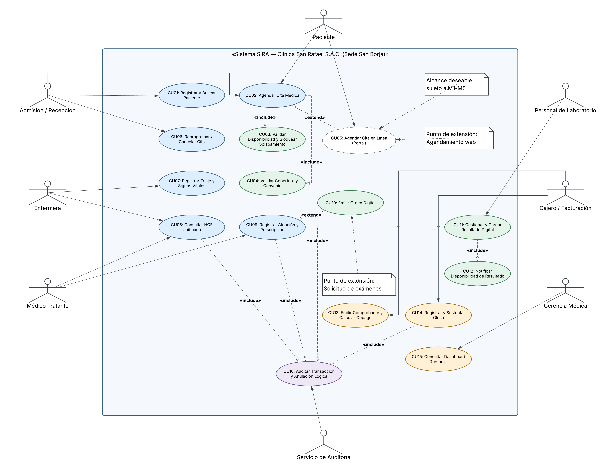
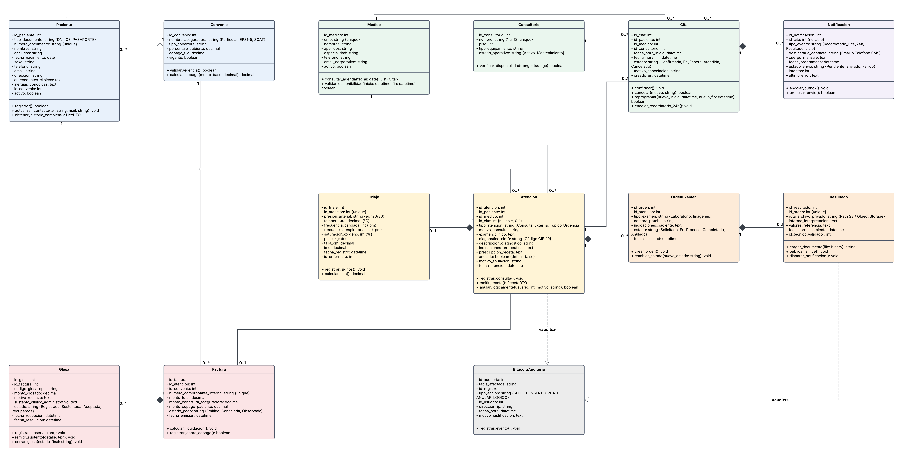

# 4. Modelos de Análisis y Diseño UML — Sistema SIRA

---

### Contexto y Metodología de Modelado (Semana 4)

El presente documento constituye la especificación formal de los **Modelos de Análisis y Diseño UML** para el **Sistema de Información Clínico-Administrativo (SIRA)** de la **Clínica San Rafael S.A.C. (Sede San Borja)**, en el marco del curso Taller de Ingeniería de Software I (SW705).

Los modelos desarrollados materializan el paso metódico del backlog de requerimientos hacia el diseño técnico preliminar:

1. **Diagrama de Casos de Uso:** Modela la frontera del sistema, los roles de interacción (actores del dominio) y los servicios funcionales ofrecidos, formalizando las dependencias mediante relaciones `«include»` y `«extend»`.
2. **Diagrama de Clases de Análisis:** Estructura conceptualmente las entidades centrales del negocio de salud, sus atributos tipados, métodos operacionales, relaciones semánticas y multiplicidades estrictas.
3. **Diagrama de Actividades:** Modela la dinámica de ejecución y las bifurcaciones de control del proceso operacional más crítico y repetitivo: el agendamiento concurrente de citas con bloqueo de solapamiento y notificación asíncrona desacoplada.

Todos los artefactos mantienen una **trazabilidad bidireccional estricta (100 % verificable)** con los Requerimientos Funcionales (RF-001 a RF-008), los Requerimientos No Funcionales (RNF-001 a RNF-005) y las Historias de Usuario (HU01 a HU13) consolidados en los documentos precedentes (`01-acta-constitucion.md`, `02-documento-vision.md` y `03-especificacion-requerimientos-ERS.md`).

---

## 4.1. Diagrama de Casos de Uso del Sistema

### 4.1.1. Identificación y Mapeo de Actores y Casos de Uso

A partir de la especificación de usuarios y el backlog priorizado, se definen los siete (07) actores del dominio y sus casos de uso correspondientes:

| Actor del Sistema                 | Tipo de Actor         | Casos de Uso Asociados                                                                                                                                                       | Módulo SIRA | Trazabilidad ERS / Backlog       |
| :-------------------------------- | :-------------------- | :--------------------------------------------------------------------------------------------------------------------------------------------------------------------------- | :----------: | :------------------------------- |
| **Admisión / Recepción**  | Primario (Humano)     | • CU01: Registrar y Buscar Paciente• CU02: Agendar Cita Médica• CU06: Reprogramar o Cancelar Cita Médica                                                                |    M1, M2    | RF-001, RF-002; HU02, HU03, HU06 |
| **Médico Tratante**        | Primario (Humano)     | • CU08: Consultar Historia Clínica Electrónica (HCE)• CU09: Registrar Atención Clínica y Prescripción Médica• CU10: Emitir Orden Digital de Laboratorio / Imágenes |    M1, M3    | RF-001, RF-004; HU01, HU04       |
| **Enfermera**               | Primario (Humano)     | • CU07: Registrar Triaje y Signos Vitales• CU08: Consultar Historia Clínica Electrónica (acceso restringido a triaje/alergias)                                           |      M1      | RF-001; HU05                     |
| **Personal de Laboratorio** | Primario (Humano)     | • CU11: Gestionar Orden y Cargar Resultado Digital• CU12: Notificar Disponibilidad de Resultado                                                                            |      M3      | RF-005; HU09                     |
| **Cajero / Facturación**   | Primario (Humano)     | • CU13: Emitir Comprobante y Calcular Copago• CU14: Registrar y Sustentar Glosa de EPS                                                                                     |      M4      | RF-006, RF-007; HU10, HU11       |
| **Gerencia Médica**        | Primario (Humano)     | • CU15: Consultar Dashboard Gerencial de Indicadores                                                                                                                        |      M5      | RF-008; HU12                     |
| **Paciente**                | Secundario / Primario | • CU02: Receptor de Agendamiento / Notificación 24 h• CU05: Agendar Cita en Línea desde Portal (Condicional M6)                                                          |    M2, M6    | RF-003; HU07, HU13               |
| **Servicio de Auditoría**  | Secundario (Sistema)  | • CU16: Auditar Transacción Clínica y Anulación Lógica                                                                                                                  | Transversal | RNF-002, RNF-004; HU08           |

---

### 4.1.2. Catálogo y Especificación de Casos de Uso

A continuación se especifican formalmente los casos de uso modelados dentro del límite del sistema:

#### CU01: Registrar y Buscar Paciente

* **Actor Principal:** Personal de Admisión / Recepción.
* **Módulo:** M1 — Historia Clínica Electrónica.
* **Precondición:** Operador autenticado en el sistema con rol de Admisión.
* **Flujo Principal:**
  1. El operador ingresa el tipo y número de documento (DNI/CE).
  2. El sistema busca al paciente en la base de datos centralizada.
  3. Si existe, despliega los datos de filiación, antecedentes generales y estado de convenio.
  4. Si no existe, el sistema habilita el formulario de captura mínima (nombres, apellidos, fecha de nacimiento, sexo, teléfono, correo, convenio asegurador).
  5. El operador completa los datos y confirma el guardado.
* **Postcondición:** Paciente registrado y habilitado para agendamiento o atención médica inmediata.

#### CU02: Agendar Cita Médica

* **Actor Principal:** Personal de Admisión / Recepción (y Paciente vía CU05 si aplica M6).
* **Módulo:** M2 — Agenda y Citas Médicas.
* **Precondición:** Paciente previamente registrado en el sistema.
* **Relaciones:**
  * `«include»` hacia **CU03: Validar Disponibilidad y Bloquear Solapamiento** (obligatorio).
  * `«include»` hacia **CU04: Validar Cobertura y Convenio de Aseguradora** (obligatorio).
  * `«extend»` desde **CU05: Agendar Cita en Línea desde Portal** (extensión condicional para M6).
* **Flujo Principal:**
  1. El operador selecciona al paciente y solicita agendamiento.
  2. Selecciona la especialidad requerida y el rango de fechas deseadas.
  3. El sistema ejecuta CU03 y CU04 para mostrar únicamente los bloques válidos.
  4. El operador elige médico, consultorio (entre los 12 disponibles) y horario.
  5. El sistema reserva transaccionalmente el bloque horario y emite la confirmación.
  6. El sistema encola el recordatorio de 24 horas en el gestor asíncrono.
* **Flujo Alternativo (Solapamiento Concurrente):** En CU03, si dos operadores seleccionan el mismo bloque en simultáneo, el motor transaccional bloquea el segundo intento, emite alerta de conflicto y retorna a la grilla de disponibilidad sin registrar la cita duplicada.
* **Postcondición:** Cita médica confirmada en estado `CONFIRMADA`; bloque de consultorio y médico ocupado; evento outbox registrado.

#### CU03: Validar Disponibilidad y Bloquear Solapamiento

* **Tipo:** Caso de uso incluido (`«include»` de CU02).
* **Descripción:** Subrutina del servidor que verifica en tiempo real que ni el médico asignado ni el consultorio físico tengan otra cita superpuesta en el intervalo temporal seleccionado (`tsrange`).

#### CU04: Validar Cobertura y Convenio de Aseguradora

* **Tipo:** Caso de uso incluido (`«include»` de CU02).
* **Descripción:** Verifica el estado de afiliación del paciente frente al catálogo de convenios (Particular, EPS 1 a 5 o SOAT) para parametrizar la cobertura aplicable antes de la emisión del ticket.

#### CU05: Agendar Cita en Línea desde Portal

* **Tipo:** Caso de uso de extensión (`«extend»` de CU02).
* **Condición de Extensión:** Módulo M6 habilitado en despliegue y paciente debidamente autenticado con credenciales web.
* **Descripción:** Permite al paciente acceder por autoservicio para reservar su cita ambulatoria o consulta virtual de seguimiento.

#### CU06: Reprogramar o Cancelar Cita Médica

* **Actor Principal:** Personal de Admisión / Recepción.
* **Módulo:** M2 — Agenda y Citas Médicas.
* **Precondición:** Existencia de una cita en estado `CONFIRMADA`.
* **Flujo Principal:** El operador busca la cita, selecciona reprogramación (eligiendo nuevo bloque válido) o cancelación, ingresa el motivo obligatorio y confirma. El sistema libera el consultorio y médico en la base de datos.
* **Postcondición:** Estado de la cita actualizado a `REPROGRAMADA` o `CANCELADA` con registro del motivo.

#### CU07: Registrar Triaje y Signos Vitales

* **Actor Principal:** Enfermera.
* **Módulo:** M1 — Historia Clínica Electrónica.
* **Precondición:** Paciente con cita confirmada presente en sala de espera (check-in realizado) o ingresado por Tópico de Urgencias.
* **Flujo Principal:** La enfermera ingresa al módulo de triaje, selecciona al paciente y registra los signos vitales: presión arterial, temperatura corporal, frecuencia cardíaca, peso y talla. El sistema calcula automáticamente el IMC.
* **Postcondición:** Triaje asociado a la atención del día en modo lectura para el médico tratante.

#### CU08: Consultar Historia Clínica Electrónica (HCE)

* **Actor Principal:** Médico Tratante (acceso integral) / Enfermera (acceso restringido a triaje y alergias).
* **Módulo:** M1 — Historia Clínica Electrónica.
* **Precondición:** Usuario clínico autenticado con sesión activa y token JWT verificado.
* **Relaciones:** `«include»` hacia **CU16: Auditar Transacción Clínica**.
* **Flujo Principal:** El profesional busca al paciente por documento o lo selecciona de su lista de citas del día. El sistema recupera y renderiza el expediente clínico unificado en menos de 2 segundos (RNF-001) organizando antecedentes, atenciones previas, diagnósticos CIE-10, alergias y prescripciones.
* **Postcondición:** Consulta visualizada y evento de lectura persistido en la bitácora de auditoría.

#### CU09: Registrar Atención Clínica y Prescripción Médica

* **Actor Principal:** Médico Tratante.
* **Módulo:** M1 — Historia Clínica Electrónica.
* **Precondición:** Expediente del paciente abierto y triaje del día completado.
* **Relaciones:**
  * `«extend»` hacia **CU10: Emitir Orden Digital de Laboratorio / Imágenes** (opcional, a criterio del facultativo).
  * `«include»` hacia **CU16: Auditar Transacción Clínica**.
* **Flujo Principal:** El médico registra el motivo de consulta, examen físico, diagnóstico estandarizado mediante autocompletado CIE-10, indicaciones médicas y receta farmacológica. Al presionar "Finalizar Atención", los datos se consolidan inmutablemente.
* **Postcondición:** Atención registrada en el expediente; estado de la cita actualizado a `ATENDIDA`; receta disponible para impresión o consulta.

#### CU10: Emitir Orden Digital de Laboratorio / Imágenes

* **Tipo:** Caso de uso de extensión (`«extend»` de CU09).
* **Actor Principal:** Médico Tratante.
* **Módulo:** M3 — Laboratorio e Imágenes.
* **Descripción:** Si el médico requiere pruebas diagnósticas, añade exámenes del catálogo clínico e indicaciones clínicas específicas. El sistema genera una orden digital con código único enlazada a la atención actual.

#### CU11: Gestionar Orden y Cargar Resultado Digital

* **Actor Principal:** Personal de Laboratorio / Imágenes.
* **Módulo:** M3 — Laboratorio e Imágenes.
* **Precondición:** Orden médica emitida en estado `SOLICITADO`.
* **Relaciones:** `«include»` hacia **CU12: Notificar Disponibilidad de Resultado**.
* **Flujo Principal:** El técnico consulta las órdenes pendientes, registra la recepción de muestra/toma, cambia el estado a `EN_PROCESO`, sube el informe digital (PDF/JPG) al almacenamiento privado y transcribe el informe diagnóstico. Marca la orden como `COMPLETADA`.
* **Postcondición:** Resultado vinculado permanentemente a la orden y disponible en la HCE del paciente en $\le 4$ horas.

#### CU12: Notificar Disponibilidad de Resultado

* **Tipo:** Caso de uso incluido (`«include»` de CU11).
* **Descripción:** Dispara automáticamente una alerta visual en la HCE del médico tratante y encola un mensaje (correo/SMS) al paciente informando que su resultado está listo.

#### CU13: Emitir Comprobante y Calcular Copago

* **Actor Principal:** Cajero / Facturación.
* **Módulo:** M4 — Facturación y Convenios.
* **Precondición:** Atención médica o examen auxiliar completado.
* **Flujo Principal:** El cajero carga la atención del paciente. El sistema detecta el convenio vigente (Particular, EPS 1–5 o SOAT), consulta el tarifario pactado, calcula la cobertura porcentual y el copago neto a cobrar. El cajero registra el pago y emite el comprobante de liquidación interna.
* **Postcondición:** Comprobante emitido y liquidación registrada para conciliación.

#### CU14: Registrar y Sustentar Glosa de EPS

* **Actor Principal:** Cajero / Facturación.
* **Módulo:** M4 — Facturación y Convenios.
* **Precondición:** Factura o liquidación observada formalmente por una aseguradora.
* **Flujo Principal:** El personal registra el código de glosa, motivo del rechazo, fecha y monto objetado. Adjunta el sustento clínico/administrativo y actualiza el estado a lo largo de su ciclo de vida (`REGISTRADA` $\rightarrow$ `SUSTENTADA` $\rightarrow$ `ACEPTADA` / `RECHAZADA`).
* **Postcondición:** Glosa trazada y métrica de recupero actualizada para el flujo de caja.

#### CU15: Consultar Dashboard Gerencial de Indicadores

* **Actor Principal:** Gerencia Médica / Dirección.
* **Módulo:** M5 — Reportes Gerenciales.
* **Precondición:** Usuario autenticado con rol de Gerencia Médica.
* **Flujo Principal:** El directivo ingresa al módulo, selecciona un intervalo temporal y filtros por especialidad o convenio. El sistema procesa los datos operativos y renderiza gráficos interactivos de: (1) Ocupación de los 12 consultorios, (2) Tiempos promedio de espera, (3) Tasa de inasistencia (*no-show*), y (4) Ingresos facturados vs. glosados.
* **Postcondición:** Métricas gerenciales proyectadas en tiempo real sin revelar datos clínicos individualizados.

#### CU16: Auditar Transacción Clínica y Anulación Lógica

* **Tipo:** Caso de uso transversal incluido (`«include»` de CU08, CU09, CU11, CU14).
* **Descripción:** Interceptor del sistema que registra en una bitácora inmutable el identificador de usuario, fecha, hora exacta, IP, tabla afectada, acción y motivo justificado. Gobierna de forma obligatoria la anulación lógica prohibiendo el borrado físico (`DELETE`).

---

### 4.1.3. Matriz de Trazabilidad de Casos de Uso

|  Caso de Uso  | Nombre del Caso de Uso                               |   Módulo   | Historias de Usuario | Requerimiento RF / RNF |
| :------------: | :--------------------------------------------------- | :---------: | :------------------: | :--------------------: |
| **CU01** | Registrar y Buscar Paciente                          |     M1     |         HU03         |         RF-001         |
| **CU02** | Agendar Cita Médica                                 |     M2     |         HU02         |    RF-002, RNF-005    |
| **CU03** | Validar Disponibilidad y Bloquear Solapamiento       |     M2     |         HU02         |         RF-002         |
| **CU04** | Validar Cobertura y Convenio de Aseguradora          |   M2 / M4   |      HU03, HU04      |         RF-006         |
| **CU05** | Agendar Cita en Línea desde Portal (Condicional)    |     M6     |         HU13         |         RF-002         |
| **CU06** | Reprogramar o Cancelar Cita Médica                  |     M2     |         HU06         |         RF-002         |
| **CU07** | Registrar Triaje y Signos Vitales                    |     M1     |         HU05         |         RF-001         |
| **CU08** | Consultar Historia Clínica Electrónica (HCE)       |     M1     |         HU01         |    RF-001, RNF-001    |
| **CU09** | Registrar Atención Clínica y Prescripción Médica |     M1     |         HU04         |         RF-001         |
| **CU10** | Emitir Orden Digital de Laboratorio / Imágenes      |     M3     |         HU04         |         RF-004         |
| **CU11** | Gestionar Orden y Cargar Resultado Digital           |     M3     |         HU09         |         RF-005         |
| **CU12** | Notificar Disponibilidad de Resultado                |     M3     |         HU09         |         RF-005         |
| **CU13** | Emitir Comprobante y Calcular Copago                 |     M4     |         HU10         |         RF-006         |
| **CU14** | Registrar y Sustentar Glosa de EPS                   |     M4     |         HU11         |         RF-007         |
| **CU15** | Consultar Dashboard Gerencial de Indicadores         |     M5     |         HU12         |         RF-008         |
| **CU16** | Auditar Transacción Clínica y Anulación Lógica   | Transversal |         HU08         |    RNF-002, RNF-004    |

---

### 4.1.4. Inserción del Diagrama de Casos de Uso



*Figura 4.1. Diagrama General de Casos de Uso del Sistema SIRA (Clínica San Rafael S.A.C., Sede San Borja).*

## 4.2. Diagrama de Clases de Análisis

### 4.2.1. Identificación de Clases y Entidades del Dominio

El diagrama de clases modela la estructura estática del dominio clínico-administrativo. Las clases candidatas se extrajeron de los sustantivos del modelo del dominio, los requerimientos funcionales y las reglas del caso:

1. **`Paciente`:** Representa al sujeto de atención de salud en la clínica.
2. **`Convenio`:** Modela los acuerdos de cobertura (Particular, EPS 1–5, SOAT).
3. **`Medico`:** Profesional asistencial habilitado con colegiatura médica (CMP) y especialidad.
4. **`Consultorio`:** Espacio físico de atención ambulatoria (12 consultorios disponibles en la sede).
5. **`Cita`:** Reservación formal de espacio temporal entre un paciente, médico y consultorio.
6. **`Triaje`:** Parámetros fisiológicos y signos vitales capturados por enfermería.
7. **`Atencion`:** Acto médico que consolida la consulta, juicio diagnóstico y terapéutica.
8. **`OrdenExamen`:** Solicitud diagnóstica de laboratorio o diagnóstico por imágenes.
9. **`Resultado`:** Informe y archivo digital que responde a una orden médica ejecutada.
10. **`Factura`:** Liquidación económica y comprobante interno emitido por la atención o examen.
11. **`Glosa`:** Observación o rechazo de pago parcial o total emitido por una aseguradora.
12. **`Notificacion`:** Registro desacoplado de alerta o recordatorio programado (Patrón Outbox).
13. **`BitacoraAuditoria`:** Registro inmutable de trazabilidad y anulación lógica (RNF-002, RNF-004).
14. **`Usuario` y `Rol`:** Entidades transversales para la gestión de autenticación y RBAC.

---

### 4.2.2. Diccionario de Clases: Atributos, Métodos y Visibilidad

A continuación se detalla la especificación de clases con visibilidad UML (`+` público, `-` privado, `#` protegido):

```text
+-----------------------------------------------------------------------+
|                               Paciente                                |
+-----------------------------------------------------------------------+
| - id_paciente: int                                                    |
| - tipo_documento: string {DNI, CE, PASAPORTE}                         |
| - numero_documento: string {unique}                                   |
| - nombres: string                                                     |
| - apellidos: string                                                   |
| - fecha_nacimiento: date                                              |
| - sexo: string                                                        |
| - telefono: string                                                    |
| - email: string                                                       |
| - direccion: string                                                   |
| - antecedentes_clinicos: text                                         |
| - alergias_conocidas: text                                            |
| - id_convenio: int                                                    |
| - activo: boolean                                                     |
+-----------------------------------------------------------------------+
| + registrar(): boolean                                                |
| + actualizar_contacto(tel: string, mail: string): void                |
| + obtener_historia_completa(): HceDTO                                 |
+-----------------------------------------------------------------------+

+-----------------------------------------------------------------------+
|                               Convenio                                |
+-----------------------------------------------------------------------+
| - id_convenio: int                                                    |
| - nombre_aseguradora: string {Particular, EPS1-5, SOAT}               |
| - tipo_cobertura: string                                              |
| - porcentaje_cubierto: decimal                                        |
| - copago_fijo: decimal                                                |
| - vigente: boolean                                                    |
+-----------------------------------------------------------------------+
| + validar_vigencia(): boolean                                         |
| + calcular_copago(monto_base: decimal): decimal                       |
+-----------------------------------------------------------------------+

+-----------------------------------------------------------------------+
|                                Medico                                 |
+-----------------------------------------------------------------------+
| - id_medico: int                                                      |
| - cmp: string {unique}                                                |
| - nombres: string                                                     |
| - apellidos: string                                                   |
| - especialidad: string                                                |
| - telefono: string                                                    |
| - email_corporativo: string                                           |
| - activo: boolean                                                     |
+-----------------------------------------------------------------------+
| + consultar_agenda(fecha: date): List<Cita>                           |
| + validar_disponibilidad(inicio: datetime, fin: datetime): boolean    |
+-----------------------------------------------------------------------+

+-----------------------------------------------------------------------+
|                              Consultorio                              |
+-----------------------------------------------------------------------+
| - id_consultorio: int                                                 |
| - numero: string {1 al 12, unique}                                    |
| - piso: int                                                           |
| - tipo_equipamiento: string                                           |
| - estado_operativo: string {Activo, Mantenimiento}                    |
+-----------------------------------------------------------------------+
| + verificar_disponibilidad(rango: tsrange): boolean                   |
+-----------------------------------------------------------------------+

+-----------------------------------------------------------------------+
|                                 Cita                                  |
+-----------------------------------------------------------------------+
| - id_cita: int                                                        |
| - id_paciente: int                                                    |
| - id_medico: int                                                      |
| - id_consultorio: int                                                 |
| - fecha_hora_inicio: datetime                                         |
| - fecha_hora_fin: datetime                                            |
| - estado: string {Confirmada, En_Espera, Atendida, Cancelada}         |
| - motivo_cancelacion: string                                          |
| - creado_en: datetime                                                 |
+-----------------------------------------------------------------------+
| + confirmar(): void                                                   |
| + cancelar(motivo: string): boolean                                   |
| + reprogramar(nuevo_inicio: datetime, nuevo_fin: datetime): boolean   |
| + encolar_recordatorio_24h(): void                                    |
+-----------------------------------------------------------------------+

+-----------------------------------------------------------------------+
|                                Triaje                                 |
+-----------------------------------------------------------------------+
| - id_triaje: int                                                      |
| - id_atencion: int {unique}                                           |
| - presion_arterial: string {ej. 120/80}                               |
| - temperatura: decimal {°C}                                           |
| - frecuencia_cardiaca: int {lpm}                                      |
| - frecuencia_respiratoria: int {rpm}                                  |
| - saturacion_oxigeno: int {%}                                         |
| - peso_kg: decimal                                                    |
| - talla_cm: decimal                                                   |
| - imc: decimal                                                        |
| - fecha_registro: datetime                                            |
| - id_enfermera: int                                                   |
+-----------------------------------------------------------------------+
| + registrar_signos(): void                                            |
| + calcular_imc(): decimal                                             |
+-----------------------------------------------------------------------+

+-----------------------------------------------------------------------+
|                               Atencion                                |
+-----------------------------------------------------------------------+
| - id_atencion: int                                                    |
| - id_paciente: int                                                    |
| - id_medico: int                                                      |
| - id_cita: int {nullable, 0..1}                                       |
| - tipo_atencion: string {Consulta_Externa, Topico_Urgencia}           |
| - motivo_consulta: string                                             |
| - examen_clinico: text                                                |
| - diagnostico_cie10: string {Código CIE-10}                           |
| - descripcion_diagnostico: string                                     |
| - indicaciones_terapeuticas: text                                     |
| - prescripcion_receta: text                                           |
| - anulado: boolean {default false}                                    |
| - motivo_anulacion: string                                            |
| - fecha_atencion: datetime                                            |
+-----------------------------------------------------------------------+
| + registrar_consulta(): void                                          |
| + emitir_receta(): RecetaDTO                                          |
| + anular_logicamente(usuario: int, motivo: string): boolean           |
+-----------------------------------------------------------------------+

+-----------------------------------------------------------------------+
|                              OrdenExamen                              |
+-----------------------------------------------------------------------+
| - id_orden: int                                                       |
| - id_atencion: int                                                    |
| - tipo_examen: string {Laboratorio, Imagenes}                         |
| - nombre_prueba: string                                               |
| - indicaciones_paciente: text                                         |
| - estado: string {Solicitado, En_Proceso, Completado, Anulado}        |
| - fecha_solicitud: datetime                                           |
+-----------------------------------------------------------------------+
| + crear_orden(): void                                                 |
| + cambiar_estado(nuevo_estado: string): void                          |
+-----------------------------------------------------------------------+

+-----------------------------------------------------------------------+
|                               Resultado                               |
+-----------------------------------------------------------------------+
| - id_resultado: int                                                   |
| - id_orden: int {unique}                                              |
| - ruta_archivo_privado: string {Path S3 / Object Storage}              |
| - informe_interpretacion: text                                        |
| - valores_referencia: text                                            |
| - fecha_procesamiento: datetime                                       |
| - id_tecnico_validador: int                                           |
+-----------------------------------------------------------------------+
| + cargar_documento(file: binary): string                              |
| + publicar_a_hce(): void                                              |
| + disparar_notificacion(): void                                       |
+-----------------------------------------------------------------------+

+-----------------------------------------------------------------------+
|                                Factura                                |
+-----------------------------------------------------------------------+
| - id_factura: int                                                     |
| - id_atencion: int                                                    |
| - id_convenio: int                                                    |
| - numero_comprobante_interno: string {unique}                         |
| - monto_total: decimal                                                |
| - monto_cobertura_aseguradora: decimal                                |
| - monto_copago_paciente: decimal                                      |
| - estado_pago: string {Emitida, Cancelada, Observada}                 |
| - fecha_emision: datetime                                             |
+-----------------------------------------------------------------------+
| + calcular_liquidacion(): void                                        |
| + registrar_cobro_copago(): boolean                                   |
+-----------------------------------------------------------------------+

+-----------------------------------------------------------------------+
|                                 Glosa                                 |
+-----------------------------------------------------------------------+
| - id_glosa: int                                                       |
| - id_factura: int                                                     |
| - codigo_glosa_eps: string                                            |
| - monto_glosado: decimal                                              |
| - motivo_rechazo: text                                                |
| - sustento_clinico_administrativo: text                               |
| - estado: string {Registrada, Sustentada, Aceptada, Recuperada}       |
| - fecha_recepcion: datetime                                           |
| - fecha_resolucion: datetime                                          |
+-----------------------------------------------------------------------+
| + registrar_observacion(): void                                       |
| + remitir_sustento(detalle: text): void                               |
| + cerrar_glosa(estado_final: string): void                            |
+-----------------------------------------------------------------------+

+-----------------------------------------------------------------------+
|                             Notificacion                              |
+-----------------------------------------------------------------------+
| - id_notificacion: int                                                |
| - id_cita: int {nullable}                                             |
| - tipo_evento: string {Recordatorio_Cita_24h, Resultado_Listo}        |
| - destinatario_contacto: string {Email o Telefono SMS}                |
| - cuerpo_mensaje: text                                                |
| - fecha_programada: datetime                                          |
| - estado_envio: string {Pendiente, Enviado, Fallido}                  |
| - intentos: int                                                       |
| - ultimo_error: text                                                  |
+-----------------------------------------------------------------------+
| + encolar_outbox(): void                                              |
| + procesar_envio(): boolean                                           |
+-----------------------------------------------------------------------+

+-----------------------------------------------------------------------+
|                           BitacoraAuditoria                           |
+-----------------------------------------------------------------------+
| - id_auditoria: int                                                   |
| - tabla_afectada: string                                              |
| - id_registro: int                                                    |
| - tipo_accion: string {SELECT, INSERT, UPDATE, ANULAR_LOGICO}         |
| - id_usuario: int                                                     |
| - direccion_ip: string                                                |
| - fecha_hora: datetime                                                |
| - motivo_justificacion: text                                          |
+-----------------------------------------------------------------------+
| + registrar_evento(): void                                            |
+-----------------------------------------------------------------------+
```

---

### 4.2.3. Especificación de Relaciones y Multiplicidades del Dominio

A continuación se fundamentan las relaciones, tipos de acoplamiento y multiplicidades exactas entre clases:

| Clase Origen            | Multiplicidad |    Tipo de Relación    | Multiplicidad | Clase Destino               | Semántica del Negocio Clínico                                                                                                                                                                                      |
| :---------------------- | :-----------: | :---------------------: | :-----------: | :-------------------------- | :------------------------------------------------------------------------------------------------------------------------------------------------------------------------------------------------------------------- |
| **Paciente**      |     `1`     |       Asociación       |   `0..*`   | **Cita**              | Un paciente puede tener cero o múltiples citas programadas; cada cita pertenece obligatoriamente a un paciente único.                                                                                              |
| **Paciente**      |     `1`     |       Asociación       |   `0..*`   | **Atencion**          | Un paciente tiene un historial de cero a muchas atenciones médicas en su HCE.                                                                                                                                       |
| **Convenio**      |     `1`     |       Agregación       |   `0..*`   | **Paciente**          | Un convenio cubre a muchos pacientes; un paciente está adscrito a un convenio activo (Particular si no tiene seguro).                                                                                               |
| **Convenio**      |     `1`     |       Asociación       |   `0..*`   | **Factura**           | Una factura aplica las reglas tarifarias de un convenio específico.                                                                                                                                                 |
| **Medico**        |     `1`     |       Asociación       |   `0..*`   | **Cita**              | Un médico atiende una lista de citas en su turno; cada cita reserva a un único médico.                                                                                                                            |
| **Medico**        |     `1`     |       Asociación       |   `0..*`   | **Atencion**          | Un médico es autor y responsable clínico de múltiples atenciones.                                                                                                                                                 |
| **Consultorio**   |     `1`     |       Asociación       |   `0..*`   | **Cita**              | Un consultorio físico alberga citas secuenciales; cada cita se asigna a un consultorio específico.                                                                                                                 |
| **Cita**          |   `0..1`   |       Asociación       |     `1`     | **Atencion**          | **Regla clave del modelo:** Una atención puede provenir de una cita agendada (`1..1`) O de una atención directa en Tópico de Urgencias (`0..1`), garantizando la cobertura de emergencias ambulatorias. |
| **Cita**          |     `1`     |      Composición      |   `0..*`   | **Notificacion**      | Una cita genera sus registros de recordatorio en la tabla Outbox. Si se anula la cita, se cancelan sus notificaciones pendientes.                                                                                    |
| **Atencion**      |     `1`     |      Composición      |   `0..1`   | **Triaje**            | Una atención ambulatoria posee como máximo un registro de signos vitales (triaje). El triaje no existe independientemente de la atención del día.                                                                |
| **Atencion**      |     `1`     |      Composición      |   `0..*`   | **OrdenExamen**       | De una consulta médica pueden derivarse cero o varias órdenes diagnósticas.                                                                                                                                       |
| **OrdenExamen**   |     `1`     |      Composición      |   `0..1`   | **Resultado**         | Una orden médica completada contiene exactamente un resultado diagnóstico estructurado y su archivo privado.                                                                                                       |
| **Atencion**      |     `1`     |       Asociación       |   `0..1`   | **Factura**           | Una atención genera una liquidación/factura para el cobro del copago y conciliación.                                                                                                                              |
| **Factura**       |     `1`     |      Composición      |   `0..*`   | **Glosa**             | Una factura puede recibir cero o varias observaciones/glosas por parte de las EPS.                                                                                                                                   |
| **Usuario / Rol** |     `1`     | Dependencia Transversal |   `0..*`   | **BitacoraAuditoria** | Todo acceso a la HCE o anulación clínica se traza a un usuario autenticado.                                                                                                                                        |

---

### 4.2.4. Inserción del Diagrama de Clases



*Figura 4.2. Diagrama de Clases de Análisis del Sistema SIRA (Entidades, Atributos, Operaciones y Multiplicidades).*

## 4.3. Diagrama de Actividades del Proceso Central

### 4.3.1. Justificación del Proceso Central Modelado

Se selecciona el proceso **Agendamiento Concurrente de Citas Médicas con Bloqueo de Solapamientos y Notificación Asíncrona (M2 / HU02, HU07)** como el proceso central del sistema SIRA por las siguientes razones de ingeniería:

1. **Impacto Crítico en la Operación:** Ataca directamente los dos mayores focos de pérdidas de la clínica: los 20 minutos de saturación telefónica en admisión y el 18 % de inasistencia (*no-show*) por ausencia de recordatorios estructurados.
2. **Cumplimiento Estricto de Requerimientos:** Implementa directamente **RF-002** (bloqueo en tiempo real de solapamientos entre médicos y consultorios), **RF-003** (notificación obligatoria a 24 horas), **RNF-003** (disponibilidad operativa continua) y **RNF-005** (interfaz optimizada en máximo 3 pasos).
3. **Complejidad Concurrente y Transaccional:** Representa la interacción más demandante entre el cliente web, la API REST, la base de datos relacional (bloqueo pesimista/exclusión GiST) y el despachador asíncrono de mensajería (Patrón Outbox desacoplado).

---

### 4.3.2. Definición de Carriles (Swimlanes) y Responsabilidades

El diagrama se organiza en cuatro (04) carriles de responsabilidad funcional y técnica:

| Carril (Swimlane)                                 | Capa / Entorno                       | Responsabilidad en el Proceso                                                                                                                                                                                                                  |
| :------------------------------------------------ | :----------------------------------- | :--------------------------------------------------------------------------------------------------------------------------------------------------------------------------------------------------------------------------------------------- |
| **Personal de Admisión / Paciente**        | Interfaz Web (Frontend React)        | • Ingresar criterio de búsqueda del paciente.• Completar datos de filiación si es nuevo.• Seleccionar especialidad, médico, consultorio y bloque libre.• Revisar y confirmar agendamiento en$\le 3$ pasos.                            |
| **Servidor SIRA (API REST)**                | Lógica de Negocio (FastAPI Backend) | • Validar autenticación, rol y formato de entrada.• Coordinar verificación de cobertura de convenio.• Iniciar transacción atómica y gestionar excepciones de concurrencia.• Retornar DTO de confirmación o HTTP 409 Conflicto.        |
| **Base de Datos (PostgreSQL)**              | Persistencia Relacional              | • Ejecutar consultas indexadas de disponibilidad.• Aplicar restricción de exclusión física`tsrange` anti-solapamiento.• Persistir registro de `citas` y evento en `outbox_notificaciones` en el mismo commit.                      |
| **Trabajador Asíncrono de Notificaciones** | Procesamiento en Segundo Plano       | • Polling periódico de eventos pendientes en outbox.• Filtrar citas que entran en la ventana de 24 horas previas.• Invocar adaptador de correo/SMS externo sin bloquear la API.• Actualizar estado de envío e intentos en base de datos. |

---

### 4.3.3. Descripción Detallada del Flujo Operativo y Alternativas

```text
[Inicio] (Carril Admisión)
   │
   ▼
[Ingresar tipo y número de documento del paciente]
   │
   ▼
[API: Consultar existencia de paciente] (Carril API) ──► [BD: Buscar por documento indexado] (Carril BD)
                                                               │
                                                               ▼
                                                  <¿Paciente ya existe?> (Rombo Decisión 1)
                                                     /                \
                                                [NO]                   [SÍ]
                                                 /                        \
      [Desplegar formulario de alta mínima] ◄───┘                          │
      [Ingresar nombres, contacto y convenio]                              │
      [Persistir paciente en BD]                                           │
      [Retornar paciente registrado]                                       │
                                                 \                        /
                                                  ▼                      ▼
                                       [Seleccionar especialidad médica y rango de fechas] (Paso 1)
                                                               │
                                                               ▼
                                       [API: Consultar agenda consolidada y convenios vigentes]
                                                               │
                                                               ▼
                                       [BD: Filtrar médicos activos y consultorios libres]
                                                               │
                                                               ▼
                                       [Presentar grilla de horarios disponibles]
                                                               │
                                                               ▼
                                       [Elegir médico, consultorio (1-12) y horario] (Paso 2)
                                                               │
                                                               ▼
                                       [Revisar resumen de cita y solicitar confirmación] (Paso 3)
                                                               │
                                                               ▼
                                       [API: Iniciar transacción atómica (BEGIN TRANSACTION)]
                                                               │
                                                               ▼
                                       [BD: Verificar exclusión física de solapamiento]
                                                               │
                                                               ▼
                                               <¿Médico y consultorio libres?> (Rombo Decisión 2)
                                                  /                         \
                                            [NO]                             [SÍ]
                                             /                                  \
 [API: Retornar HTTP 409 Conflicto] ◄───────┘                                    │
 [Rollback de transacción]                                                       │
 [Frontend: Alerta "Horario ocupado"]                                            │
 [Retornar a grilla de disponibilidad] ──(Reintento)                             │
                                                                                 │
                                                                                 ▼
                                                     [BD: INSERT en tabla 'citas' (Confirmada)]
                                                     [BD: INSERT en tabla 'outbox_notificaciones']
                                                     [BD: COMMIT TRANSACTION]
                                                                                 │
                                                                                 ▼
                                                     [API: Generar Comprobante CitaDTO]
                                                                                 │
                                                                                 ▼
                                                     [Frontend: Mostrar ticket y confirmación]
                                                                                 │
                                                                                 ▼
                                                                              [FIN]
                                                                                 :
               - - - - - - - - - - - - - - - - - - - - - - - - - - - - - - - - - - (Flujo Asíncrono)
               :
               ▼ (Carril Trabajador Asíncrono)
         [Worker: Consultar outbox cada 60s]
               │
               ▼
         <¿Cita programada a 24 horas?> (Rombo Decisión 3)
            /                         \
       [NO]                            [SÍ]
        /                                 \
 [Esperar siguiente ciclo]                 ▼
                             [Consumir Adaptador de SMS/Email]
                             [Llamar pasarela externa vía HTTPS]
                                          │
                                          ▼
                                 <¿Envío exitoso?>
                                    /           \
                               [SÍ]              [NO]
                                /                   \
       [UPDATE outbox: ENVIADO]        [Registrar error e incrementar intento]
```

* **Cumplimiento de RNF-005 (Usabilidad en 3 pasos):**
  1. *Paso 1:* Búsqueda/selección o alta rápida del paciente.
  2. *Paso 2:* Selección de especialidad, médico, consultorio y bloque libre en la grilla visual.
  3. *Paso 3:* Revisión de cobertura/copago estimado y confirmación inmediata.

---

### 4.3.4. Inserción del Diagrama de Actividades


*Figura 4.3 Diagrama de Actividades UML para el Proceso de Agendamiento de Citas con Bloqueo de Solapamientos (Swimlanes y Patrón Outbox).*


## 4.4. Checklist de Calidad y Consistencia del Modelado UML (Rúbrica Semana 4)

El presente avance ha sido auditado contra los criterios de evaluación de la **Rúbrica de la Semana 4 (Escala Vigesimal 0–20)** para asegurar la obtención de la calificación **Logrado (18–20)**:

| Criterio de Rúbrica                           |      Peso      |      Evaluación SIRA      | Justificación Técnica de Cumplimiento                                                                                                                                                                                                                                                                                         |
| :--------------------------------------------- | :-------------: | :------------------------: | :------------------------------------------------------------------------------------------------------------------------------------------------------------------------------------------------------------------------------------------------------------------------------------------------------------------------------ |
| **Diagrama de Casos de Uso**             | **25 %** | **Logrado (18–20)** | • 7 actores modelados y alineados a las HUs.• Frontera del sistema web explícita para la sede San Borja.• Uso riguroso y semánticamente correcto de `«include»` (obligatorios) y `«extend»` (portal condicional y órdenes).                                                                                       |
| **Diagrama de Clases de Análisis**      | **30 %** | **Logrado (18–20)** | • 14 clases exhaustivas trazadas al backlog con atributos tipados y operaciones.• Multiplicidades explícitas en ambos extremos sin relaciones huérfanas.• Manejo de la regla clínica `Cita (0..1) - (1) Atencion` para tópicos de urgencia.• Composiciones para Triaje, Órdenes, Resultados y Notificaciones Outbox. |
| **Diagrama de Actividades**              | **25 %** | **Logrado (18–20)** | • Flujo modelado sobre el proceso central de agendamiento en 4 swimlanes técnicos.• Bifurcaciones bien definidas para paciente no registrado y solapamiento concurrente.• Transaccionalidad atómica y desacoplamiento asíncrono para el recordatorio de 24 h.                                                             |
| **Consistencia y Trazabilidad Avance 2** | **20 %** | **Logrado (18–20)** | • Consistencia total de nombres, roles, atributos y entidades entre la ERS (Semana 3) y los modelos UML.• Matriz de trazabilidad bidireccional CU vs. HU vs. RF/RNF completa.• Preparación directa para el modelo relacional de BD (Semana 6).                                                                              |
| **Total Ponderado**                      | **100 %** | **Logrado (18–20)** | **Cumplimiento integral de los estándares de ingeniería de software del curso.**                                                                                                                                                                                                                                        |
```
