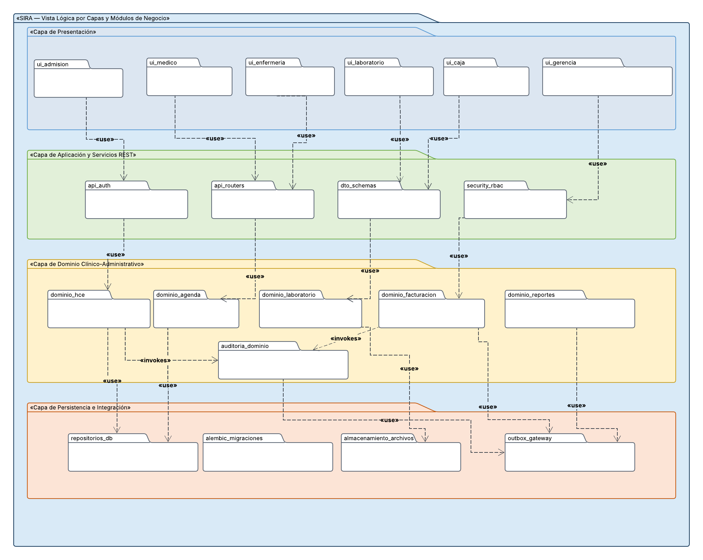

# 5. Documento de Arquitectura de Software (SAD) — Sistema SIRA

**Sistema:** Sistema de Información Clínico-Administrativo (SIRA)
**Organización:** Clínica San Rafael S.A.C., Sede San Borja
**Versión:** 1.0 (Línea Base para Entregable 1 — Semana 6)
**Fecha:** 9 de octubre de 2026
**Equipo de Desarrollo:** Grupo A (Albino Soto, Christopher Henrry; Inga Champi, Franz Joe; Rashuaman Sapallanay, Ricco Didier)

---

## 5.1. Estilo Arquitectónico

### 5.1.1. Estilo Seleccionado

Se adopta formalmente una **arquitectura web cliente-servidor basada en un Monolito Modular organizado en capas y expuesto mediante una API RESTful desacoplada**.

```text
                                  ARQUITECTURA SIRA
┌────────────────────────────────────────────────────────────────────────────────────────┐
│  CAPA DE PRESENTACIÓN (SPA React 18 + TypeScript + Vite + Tailwind CSS)                 │
│  [Módulos UI: Admisión | Consulta HCE | Triaje | Laboratorio | Caja/Facturación | KPI] │
└────────────────────────────────────────┬───────────────────────────────────────────────┘
                                         │ HTTPS / JSON (TLS 1.3) + JWT Bearer
┌────────────────────────────────────────▼───────────────────────────────────────────────┐
│  CAPA DE APLICACIÓN Y API (FastAPI / Python 3.12)                                      │
│  [API Gateway / Router | Autenticación JWT | Middleware RBAC | Handlers de Casos de Uso]│
├────────────────────────────────────────────────────────────────────────────────────────┤
│  CAPA DE DOMINIO — MONOLITO MODULAR (Módulos con límites y responsabilidades aisladas)│
│  ┌──────────────┐ ┌──────────────┐ ┌──────────────┐ ┌──────────────┐ ┌──────────────┐ │
│  │ M1: HCE y    │ │ M2: Agenda   │ │ M3: Órdenes  │ │ M4: Facturas │ │ M5: Reportes │ │
│  │     Triaje   │ │    y Citas   │ │    y Result. │ │    y Glosas  │ │    Gerenc.   │ │
│  └──────┬───────┘ └──────┬───────┘ └──────┬───────┘ └──────┬───────┘ └──────┬──────┘ │
│         │                │                │                │                │         │
│  ┌──────┴────────────────┴────────────────┴────────────────┴────────────────┴───────┐ │
│  │ SERVICIOS TRANSVERSALES: Interceptor de Auditoría Inmutable | Outbox Worker       │ │
│  └────────────────────────────────────────┬─────────────────────────────────────────┘ │
├───────────────────────────────────────────┼────────────────────────────────────────────┤
│  CAPA DE PERSISTENCIA E INFRAESTRUCTURA   │                                            │
│  ┌────────────────────────────────────────▼───┐  ┌──────────────────────────────────┐  │
│  │ Base de Datos Relacional: PostgreSQL 16    │  │ Almacenamiento Privado Seguro    │  │
│  │ (Entidades, Restricciones GIST, Outbox)    │  │ (Archivos PDF/JPG de Resultados) │  │
│  └────────────────────────────────────────────┘  └──────────────────────────────────┘  │
└────────────────────────────────────────────────────────────────────────────────────────┘
```

#### Fundamentos del Estilo

1. **Frontend Desacoplado:** Interfaz de usuario estructurada como Single Page Application (SPA) web adaptativa (*responsive*). La interfaz delega la totalidad de las reglas de validación y seguridad al backend; no opera como frontera de confianza.
2. **Backend Monolítico Modular:** La lógica de negocio reside en un único artefacto ejecutable desplegable en el servidor, organizado internamente en módulos funcionales de alta cohesión y bajo acoplamiento:

   - **M1 — Historia Clínica Electrónica y Triaje:** Administración de expedientes unificados, consultas médicas ambulatorias, atenciones de tópico de urgencia, diagnósticos estandarizados CIE-10, prescripción farmacológica y bitácora de triaje asistencial.
   - **M2 — Agenda y Citas Médicas:** Disponibilidad consolidada de los 12 consultorios, calendario de turnos médicos, motor de prevención transaccional de solapamientos y gestión de estados de citas.
   - **M3 — Laboratorio e Imágenes:** Circuito de órdenes médicas de apoyo diagnóstico, catálogo de exámenes, control de estados de procesamiento, custodia de informes digitales y alerta de disponibilidad.
   - **M4 — Facturación y Convenios:** Motor tarifario multicobertura (Particular, EPS 1–5 y SOAT), liquidación automatizada de copagos/deducibles, comprobantes internos y ciclo de vida de glosas.
   - **M5 — Reportes Gerenciales:** Agregación analítica de datos operativos para el cálculo dinámico de indicadores de ocupación, tiempos de espera, recaudación e inasistencia (*no-show*).
   - **M6 — Portal del Paciente (Condicional / Deseable):** Extensión de autoservicio para consulta de agenda y resultados propios, supeditado a la entrega de M1–M5.
3. **Persistencia Unificada y Archivos Seguros:** Una única base de datos relacional PostgreSQL 16 garantiza la consistencia transaccional y la integridad referencial (ACID) entre citas, atenciones y facturación. Los resultados digitales pesados (PDFs, JPGs) se almacenan en un repositorio privado de objetos, preservando en la base de datos únicamente sus metadatos y sumas de verificación (*hash SHA-256*).
4. **Desacoplamiento Asíncrono (Patrón Outbox):** Las tareas con dependencias de red externas o diferidas en el tiempo (como el envío de recordatorios de citas con 24 h de anticipación o las notificaciones de resultados) se persisten en una tabla transaccional `outbox_notificaciones` y son procesadas por un proceso trabajador en segundo plano (*Background Worker*), blindando el rendimiento del usuario interactivo.

---

### 5.1.2. Alternativas Arquitectónicas Evaluadas

| Criterio de Comparación                                      | Alternativa 1: Microservicios Independientes                                                                                                                                                       | Alternativa 2: Monolito No Estructurado (Tradicional)                                                                                               | Alternativa 3: Monolito Modular en Capas (Seleccionada)                                                                                                                            |
| ------------------------------------------------------------- | -------------------------------------------------------------------------------------------------------------------------------------------------------------------------------------------------- | --------------------------------------------------------------------------------------------------------------------------------------------------- | ---------------------------------------------------------------------------------------------------------------------------------------------------------------------------------- |
| **Complejidad de Despliegue y Operación**              | **Muy Alta:** Requiere orquestación de múltiples contenedores, service discovery, API Gateways distribuidos y monitoreo complejo. Inviable para un equipo de 3 desarrolladores.            | **Muy Baja:** Un solo paquete de código sin fronteras internas de diseño. Rápido de levantar en fases iniciales pero proclive al desorden. | **Baja / Moderada:** Despliegue de un único contenedor o proceso web backend; infraestructura sencilla, económica y completamente portable.                                |
| **Consistencia de Datos Transaccional**                 | **Baja / Compleja:** Requiere transacciones distribuidas (patrón Saga), consistencia eventual e infraestructura de colas (Kafka/RabbitMQ). Riesgo de estados huérfanos entre cita y cobro. | **Alta:** Transacciones relacionales directas sin límites, pero con alto riesgo de acoplamiento espagueti entre tablas cruzadas.             | **Alta:** Garantiza transacciones ACID nativas en PostgreSQL para agendamiento, atención y facturación, preservando modularidad en el código.                             |
| **Mantenibilidad y Curva de Evolución**                | **Media:** Aislamiento de código por servicio, pero fricción alta por contratos de red y sincronización de modelos.                                                                       | **Muy Baja:** Código fuertemente acoplado; una modificación en tarifas o triaje puede corromper colateralmente citas o la HCE.              | **Alta:** Alta cohesión modular; cada módulo define sus contratos internos. Facilita refactorizaciones y permite migrar módulos a servicios en el futuro si se justifica. |
| **Idoneidad para el Contexto Académico / Sede Única** | **No viable:** Sobrecarga de ingeniería desproporcionada para 8 000 pacientes sintéticos y 12 consultorios en una sola sede.                                                               | **No recomendable:** Dificulta el trabajo colaborativo en paralelo y la trazabilidad exigida por las rúbricas de ingeniería de software.    | **Óptima:** Maximiza la velocidad de entrega del equipo de 3 integrantes, cumple estrictamente las rúbricas y garantiza alta mantenibilidad.                               |

---

### 5.1.3. Descripción de Capas y Responsabilidades

1. **Capa de Presentación (Frontend SPA):**

   - Implementada en React 18 con TypeScript y empaquetada mediante Vite.
   - Organizada por características funcionales (*features* alineadas a M1–M5).
   - Consume la API REST mediante clientes tipados generados a partir del contrato OpenAPI.
   - Maneja el estado de la sesión, interceptores de token JWT y validaciones previas de formato de entrada para maximizar la usabilidad en 3 pasos (RNF-005).
2. **Capa de Aplicación y API REST (Backend Interface):**

   - Controladores y routers de FastAPI (`app/api/v1/`).
   - Deserialización, serialización y validación estricta de esquemas de datos mediante Pydantic.
   - Autenticación basada en tokens JWT con firma HMAC-SHA256 y vencimiento temporal.
   - Interceptores y middlewares de autorización basados en roles (RBAC) que protegen los recursos según el rol del usuario autenticado (RNF-002).
   - Middleware de Auditoría que intercepta transacciones clínicas y registra accesos y modificaciones en la bitácora inmutable (RNF-004).
3. **Capa de Dominio (Monolito Modular de Negocio):**

   Implementa las reglas operativas y de salud de la clínica sin acoplamiento a frameworks externos:

   - *Dominio Citas:* Validación de horarios, disponibilidad de consultorios y médicos, exclusión de solapamientos (RF-002).
   - *Dominio Clínico:* Reglas de consulta ambulatoria y tópico de urgencias, validación de códigos CIE-10, prescripción y reglas de no borrado físico (anulación lógica) (RF-001, RNF-004).
   - *Dominio Diagnóstico:* Ciclo de vida de órdenes médicas y asociación de informes de resultados (RF-004, RF-005).
   - *Dominio Facturación:* Reglas de tarifarios, liquidación de coberturas (Particular, EPS, SOAT), copagos y estados de glosas (RF-006, RF-007).
   - *Dominio Analítico:* Lógica de cálculo de indicadores agregados para la gerencia (RF-008).
4. **Capa de Persistencia e Integración:**

   - Repositorios de datos desacoplados basados en SQLAlchemy 2.0 y mapeo relacional.
   - Control de versiones del esquema de base de datos mediante migraciones con Alembic.
   - Adaptador de almacenamiento de archivos privados para resultados de laboratorio e imágenes en disco/objeto seguro.
   - Adaptador de salida para mensajería y notificaciones externas (correo/SMS) que encapsula proveedores de red.
5. **Capa de Procesamiento en Segundo Plano (Outbox Worker):**

   - Planificador periódico de baja latencia (`Async Worker / APScheduler`).
   - Escanea registros en estado `PENDIENTE` dentro de la tabla `outbox_notificaciones`.
   - Ejecuta el envío de recordatorios con 24 h de anticipación (RF-003) y alertas de resultados disponibles (RF-005), registrando reintentos e idempotencia sin degradar el tiempo de respuesta del API principal.

---

### 5.1.4. Diagrama de Componentes del Monolito Modular

*Imagen de: Componentes del Monolito Modular.*

#### Guía Paso a Paso para Construir el Diagrama en Lucidchart

1. **Lienzo y Formato:** Configura una página en orientación horizontal titulada en la cabecera: `«SIRA — Arquitectura de Componentes del Monolito Modular (Clínica San Rafael S.A.C., Sede San Borja)»`.
2. **Contenedor Externo 1 (Izquierda — Clientes Web):**

   - Dibuja un marco rotulado `«Cliente Web Adaptativo (React 18 SPA)»`.
   - Dentro, dibuja componentes: `[Módulo UI Pacientes y HCE]`, `[Módulo UI Agenda y Citas]`, `[Módulo UI Laboratorio]`, `[Módulo UI Facturación]`, `[Módulo UI Dashboard KPI]` y con borde discontinuo `[Módulo UI Portal Paciente (M6 Condicional)]`.
   - Coloca un componente transversal en la base del marco: `[Cliente HTTP Axios + Interceptor JWT]`.
3. **Canal de Comunicación:**

   - Traza una flecha horizontal bidireccional desde el `[Cliente HTTP]` hacia el backend rotulada `«HTTPS / JSON (TLS 1.3 / OpenAPI)»`.
4. **Contenedor Externo 2 (Centro — Servidor de Aplicación Monolítico):**

   - Dibuja un contenedor grande rotulado `«Servidor SIRA Backend (FastAPI / Python 3.12)»`.
   - **Subcapa API / Core:** Dibuja `[API Routers & Controllers]`, `[Security: JWT & RBAC Middleware]` y `[AuditInterceptor]`.
   - **Subcapa Dominio:** Dibuja 5 cajas de componentes:
     - `«M1» Dominio HCE, Triaje y Urgencias`
     - `«M2» Dominio Agenda y Bloqueo de Solapamientos`
     - `«M3» Dominio Órdenes y Resultados Digitales`
     - `«M4» Dominio Tarifarios, Copagos y Glosas`
     - `«M5» Dominio Métricas y Reportes Gerenciales`
     - `«M6» Dominio Portal Paciente (Borde discontinuo)`
   - **Subcapa Background Worker:** Dibuja `[Outbox Notification Worker]` y `[Adaptador Mensajería SMS/Email]`.
   - **Subcapa Persistencia:** Dibuja `[Repositorios SQLAlchemy 2.0]` y `[Gestor de Archivos Privados]`.
5. **Contenedor Externo 3 (Derecha — Almacenamiento e Infraestructura):**

   - Dibuja un cilindro rotulado `«PostgreSQL 16 Relacional»` (indicando: *Esquema Clínico-Administrativo, Índices de Rendimiento y Tabla Outbox*).
   - Dibuja un almacén rotulado `«Almacenamiento Privado de Objetos»` (indicando: *Archivos PDF/JPG de Resultados, Hash SHA-256*).
6. **Entidad Externa (Inferior Derecha):**

   - Dibuja un nodo externo `«Proveedor Cloud SMS / Correo (Gateway REST)»`.
7. **Conexiones y Flujos:**

   - Conecta los componentes UI al `[Cliente HTTP]`.
   - Conecta el `[Cliente HTTP]` a `[API Routers]`.
   - Conecta `[API Routers]` a través de `[RBAC Middleware]` hacia cada uno de los módulos de dominio (`M1` a `M5`).
   - Conecta `M1` a `M5` hacia `[Repositorios SQLAlchemy]`.
   - Conecta `M3` bidireccionalmente hacia `[Gestor de Archivos Privados]`.
   - Conecta `[Repositorios SQLAlchemy]` al cilindro de `PostgreSQL 16`.
   - Conecta `[Gestor de Archivos Privados]` al `Almacenamiento Privado de Objetos`.
   - Conecta `[Outbox Notification Worker]` mediante una flecha de consulta cíclica hacia `PostgreSQL 16 (tabla outbox)` y una flecha saliente hacia `[Adaptador Mensajería]`.
   - Conecta `[Adaptador Mensajería]` mediante HTTPS hacia `«Proveedor Cloud SMS / Correo»`.

---

## 5.2. Vistas de Arquitectura 4+1

### 5.2.1. Vista Lógica

#### Propósito

Describir la organización funcional del sistema en capas, los módulos de dominio de negocio, las principales entidades del modelo conceptual y sus fronteras de acoplamiento.

#### Elementos de la Vista Lógica

- **Capa 1: Presentación:** Componentes visuales organizados por perfil de usuario (Admisión, Médico, Enfermera, Laboratorio, Caja, Gerencia).
- **Capa 2: Aplicación:** Endpoints de FastAPI, esquemas DTO de transferencia (Pydantic), gestor de contexto de transacciones y autenticación/autorización transversal.
- **Capa 3: Dominio de Negocio:**
  - `M1_HCE`: Servicios de apertura de historia unificada, registro de consultas externas, tópico de urgencias, triaje y bajas lógicas.
  - `M2_Agenda`: Motor de validación de disponibilidad y bloqueo de concurrencia en los 12 consultorios.
  - `M3_Laboratorio`: Ciclo de órdenes y vinculación de resultados digitales.
  - `M4_Facturación`: Motor de tarifarios (Particular, EPS 1–5, SOAT), copagos y glosas.
  - `M5_Reportes`: Consultas analíticas agregadas (ocupación, espera, no-show, ingresos).
  - `Servicios Transversales`: `AuditService` y `NotificationService`.
- **Capa 4: Persistencia:** Mapeo objeto-relacional y repositorios de entidades (`PacienteRepo`, `CitaRepo`, `AtencionRepo`, `OrdenRepo`, `FacturaRepo`, `AuditoriaRepo`, `OutboxRepo`).


*Imagen de: Vista Lógica por Capas. comentario : Debe corregirse * 


---

### 5.2.2. Vista de Procesos

#### Propósito

Modelar el comportamiento dinámico, los hilos concurrentes, las transacciones críticas y la sincronización entre procesos para garantizar el bloqueo de solapamientos (RF-002) y la no pérdida de recordatorios (RF-003).

#### Proceso Clave 1: Agendamiento de Citas con Validación Concurrente (HU02 / RNF-005)

1. **Paso 1 (Admisión):** Operador busca al paciente por DNI; si no existe, ejecuta registro mínimo de filiación y cobertura.
2. **Paso 2 (Admisión):** Selecciona especialidad, consultorio y bloque de tiempo deseado sobre la matriz de disponibilidad.
3. **Procesamiento de API:** Inicia una transacción de base de datos con nivel de aislamiento controlado.
4. **Validación Anticolisión en Servidor:** Verifica transaccionalmente que ni el médico ni el consultorio posean solapamiento en el rango `[inicio, fin]`.
   - *Si hay solapamiento:* La base de datos aborta la inserción (vía restricción GiST / `FOR UPDATE`), revierte la transacción y el API devuelve `HTTP 409 Conflict`, instruyendo a la interfaz a refrescar los horarios libres sin persistir registros huérfanos.
   - *Si no hay solapamiento:* Inserta el registro de cita con `estado = 'CONFIRMADA'` e inserta simultáneamente en la misma transacción el evento en `outbox_notificaciones`.
5. **Paso 3 (Admisión):** Emite confirmación visual inmediata y comprobante de agendamiento en pantalla.
6. **Procesamiento Asíncrono Desacoplado:** El trabajador en segundo plano detecta el registro pendiente y ejecuta el envío del recordatorio 24 horas antes de la cita.

#### Proceso Clave 2: Carga y Notificación de Resultados de Diagnóstico (HU09 / RF-005)

1. El personal de laboratorio localiza la orden digital pendiente emitida desde la consulta médica.
2. Carga el documento digital (PDF/JPG) validando peso y formato.
3. El servidor calcula el resumen criptográfico (SHA-256), guarda el archivo físico en el almacenamiento privado seguro y registra los metadatos en PostgreSQL, actualizando la orden a `COMPLETADA`.
4. El sistema vincula el resultado al expediente HCE del paciente haciéndolo visible al médico tratante en 4 horas desde la toma de muestra.
5. Se inserta un evento de notificación en la tabla outbox: el trabajador asíncrono envía un SMS/correo al paciente informando que sus resultados están disponibles para recojo o consulta web, sin exponer información médica confidencial por canal inseguro (cumplimiento Ley N.° 29733).


*Imagen de: Vista de Procesos.*

#### Guía Paso a Paso para Construir la Vista de Procesos en Lucidchart

1. **Lienzo:** Diagrama de Actividades con 4 carriles verticales (*swimlanes*):

   - Carril 1: `«Personal de Admisión / Recepción»`
   - Carril 2: `«API Gateway & Servicio de Agenda (FastAPI)»`
   - Carril 3: `«Motor de Base de Datos (PostgreSQL 16)»`
   - Carril 4: `«Trabajador Asíncrono de Notificaciones»`
2. **Nodo Inicial:** Círculo relleno en Carril 1.
3. **Flujo de Captura:**

   - Actividad Carril 1: `Ingresar DNI y consultar datos del paciente`.
   - Actividad Carril 2: `Buscar paciente y validar estado de convenio activo`.
   - Decisión: `¿Paciente existe?` → Si no: `Capturar datos mínimos` → Si sí: continuar.
   - Actividad Carril 1: `Seleccionar médico, consultorio y bloque de horario (Paso 2)`.
   - Actividad Carril 2: `Iniciar transacción relacional (BEGIN)`.
4. **Validación Anticolisión en Carril 3:**

   - Actividad Carril 3: `Evaluar disponibilidad con bloqueo de concurrencia`.
   - Decisión: `¿Existe solapamiento en médico o consultorio?`.
   - Rama `[Sí - Conflicto]`: Carril 3 ejecuta `ROLLBACK` → Carril 2 retorna `HTTP 409 Conflicto` → Carril 1 muestra alerta *"Horario ocupado en simultáneo; seleccione otro bloque"* (Retorna al Paso 2).
   - Rama `[No - Libre]`: Carril 3 ejecuta inserción dual: `INSERT INTO citas (estado='CONFIRMADA')` y `INSERT INTO outbox_notificaciones (programado_para = cita.inicio - 24h)`.
   - Actividad Carril 3: `Confirmar transacción (COMMIT)`.
5. **Cierre Interactivo:**

   - Actividad Carril 2: `Retornar HTTP 201 Created con resumen de cita`.
   - Actividad Carril 1: `Desplegar confirmación y número de cita (Paso 3 completado)`.
   - Nodo Final de Interfaz (Círculo doble).
6. **Desacoplamiento Asíncrono (Carril 4):**

   - Traza una flecha discontinua desde el `COMMIT` hacia el Carril 4.
   - Actividad Carril 4: `Escanear eventos outbox pendientes al cumplirse T - 24 horas`.
   - Actividad Carril 4: `Invocar API externa de mensajería (SMS/Email)`.
   - Actividad Carril 3: `Actualizar outbox_notificaciones (estado = 'ENVIADO')`.
   - Nodo Final Asíncrono.

---

### 5.2.3. Vista de Desarrollo

#### Propósito

Especificar la estructura física y lógica del código fuente en el repositorio de GitHub, organizando las carpetas, librerías, estándares de modularidad y convenciones de prueba para asegurar el trabajo coordinado de los 3 integrantes.

#### Estructura del Repositorio (`src/` y `tests/`)

```text
sira-web-system/
├── .github/
│   └── workflows/
│       └── ci-pipeline.yml             # Integración continua: linters, tests y auditoría
├── src/
│   ├── frontend/                       # Single Page Application (React 18 + TS + Vite)
│   │   ├── public/                     # Activos estáticos, favicon y logos
│   │   └── src/
│   │       ├── app/                    # Configuración de enrutador, layout principal
│   │       ├── assets/                 # Estilos globales (Tailwind CSS)
│   │       ├── components/             # Componentes UI transversales (Botones, Modales, Tablas)
│   │       ├── features/               # Módulos organizados por dominio funcional:
│   │       │   ├── auth/               # Login, recuperación de sesión y guards de rol
│   │       │   ├── patients/           # M1: Registro de pacientes, ficha médica unificada
│   │       │   ├── appointments/       # M2: Agenda visual, asignación y cancelación de citas
│   │       │   ├── laboratory/         # M3: Bandeja de órdenes y carga de resultados digitales
│   │       │   ├── billing/            # M4: Tarifarios, cálculo de copago y glosas
│   │       │   ├── reports/            # M5: Dashboard interactivo y gráficos KPI
│   │       │   └── patient-portal/     # M6: Portal de paciente (condicional)
│   │       ├── hooks/                  # Hooks personalizados de React
│   │       ├── services/               # Clientes Axios tipados para consumo de endpoints
│   │       └── types/                  # Definiciones de tipos e interfaces TypeScript
│   │
│   └── backend/                        # Monolito Modular en Capas (FastAPI / Python 3.12)
│       └── app/
│           ├── api/                    # Capa de transporte y controladores HTTP
│           │   ├── deps.py             # Inyección de dependencias (DB session, RBAC guard)
│           │   └── v1/                 # Endpoints REST versionados por módulo:
│           │       ├── api_router.py   # Router maestro que compone los módulos
│           │       ├── auth.py         # Endpoints de autenticación JWT
│           │       ├── patients.py     # Endpoints M1 (HCE y Triaje)
│           │       ├── appointments.py # Endpoints M2 (Agenda y Citas)
│           │       ├── laboratory.py   # Endpoints M3 (Órdenes y Resultados)
│           │       ├── billing.py      # Endpoints M4 (Facturación y Glosas)
│           │       ├── reports.py      # Endpoints M5 (Dashboard de Gerencia)
│           │       └── portal.py       # Endpoints M6 (Portal Paciente condicional)
│           ├── core/                   # Configuraciones globales, secretos y seguridad
│           │   ├── config.py           # Variables de entorno y ajustes Pydantic
│           │   ├── database.py         # Configuración de Engine y SessionMaker SQLAlchemy
│           │   └── security.py         # Hashing de passwords (Bcrypt) y generación de JWT
│           ├── modules/                # Capa de Dominio (Lógica pura de negocio):
│           │   ├── patients/           # Lógica de HCE, atenciones y anulación lógica
│           │   ├── appointments/       # Motor de agenda y reglas anti-solapamiento
│           │   ├── laboratory/         # Lógica de órdenes, estados e informes
│           │   ├── billing/            # Motor tarifario, copagos y ciclo de glosas
│           │   └── reports/            # Agregaciones analíticas y cálculo de métricas
│           ├── shared/                 # Componentes y servicios transversales:
│           │   ├── audit/              # Bitácora inmutable y capturador de eventos
│           │   └── notifications/      # Worker de segundo plano y adaptadores Email/SMS
│           └── infrastructure/         # Capa de persistencia y servicios externos:
│               ├── models/             # Entidades mapeadas ORM (SQLAlchemy 2.0)
│               ├── repositories/       # Clases de acceso a datos y consultas optimizadas
│               ├── migrations/         # Scripts de migración versionados con Alembic
│               └── storage/            # Gestor de archivos privados de resultados
│
├── tests/                              # Suite integral de aseguramiento de calidad
│   ├── unit/                           # Pruebas unitarias de dominio (pytest)
│   ├── integration/                    # Pruebas de integración API y base de datos
│   └── load/                           # Scripts de prueba de carga con JMeter / Locust
├── docker-compose.yml                  # Orquestación de entorno local (App + DB)
├── Dockerfile.backend                  # Contenedor de backend FastAPI
├── Dockerfile.frontend                 # Contenedor de frontend React/Nginx
└── README.md                           # Documentación de inicio rápido y convenciones
```


*Imagen de: Vista de Desarrollo.*

#### Guía Paso a Paso para Construir la Vista de Desarrollo en Lucidchart

1. **Lienzo:** Diagrama de Componentes y Paquetes UML titulado `«SIRA — Vista de Desarrollo y Organización de Paquetes»`.
2. **Contenedor 1 (`src/frontend`):**

   - Agrupa los paquetes de la SPA: `app`, `components`, `features` (desglosado en `patients`, `appointments`, `laboratory`, `billing`, `reports`), `services` y `types`.
   - Muestra dependencias internas: `features` consume componentes de `components` y métodos de `services`.
3. **Contenedor 2 (`src/backend`):**

   - Agrupa los paquetes del backend: `api/v1` (controladores), `core` (seguridad), `modules` (dominios aislados M1–M5), `shared` (auditoría y worker) e `infrastructure` (modelos ORM, repositorios y almacenamiento).
   - Muestra dependencias permitidas: `api/v1` invoca `modules`; `modules` interactúa exclusivamente con `infrastructure/repositories` a través de interfaces de servicio.
4. **Contenedor 3 (`tests`):**

   - Muestra `unit_tests` vinculadas a `modules`, e `integration_tests` vinculadas a `api/v1` e `infrastructure`.
5. **Regla de Dependencia Visible:** Añade una nota visual que prohíba dependencias circulares entre módulos de dominio (`M1` no importa directamente código de `M4` sin pasar por contratos de servicio compartidos).

---

### 5.2.4. Vista Física (Despliegue)

#### Propósito

Especificar la infraestructura de ejecución, los nodos de computación, las zonas de red seguras, los protocolos de comunicación y la topología de despliegue para la sede San Borja de la clínica.

#### Nodos de la Topología

1. **Nodos Cliente (Perímetro Externo / Seguro):**

   - *Estaciones de Trabajo de la Clínica:* PCs y navegadores modernos en admisión, consultorios médicos, tópico de triaje, laboratorio y caja.
   - *Dispositivos Móviles / Personales de Pacientes:* Navegadores web en smartphones/laptops accediendo al portal web.
2. **Frontera de Red (Internet Seguro):**

   - Canal HTTPS exclusivo sobre TLS 1.3 con certificados SSL automáticos.
3. **Nodo de Entrada y Frontend (Servicio Web Estático):**

   - Servidor proxy reverso (Nginx o servicio cloud administrado) que sirve la SPA compilada (HTML/JS/CSS) y enruta las peticiones `/api/*` al backend.
4. **Nodo de Aplicación (Servidor SIRA Backend):**

   - Contenedor Docker en Linux ejecutando Python 3.12 con servidor ASGI de alta concurrencia (Uvicorn / FastAPI).
   - Proceso subordinado en segundo plano ejecutando el planificador de notificaciones outbox.
5. **Nodo de Base de Datos (Red Privada Aislada):**

   - Instancia administrada de PostgreSQL 16 ubicada en subred privada sin dirección IP pública. Solo accesible desde el backend por el puerto 5432 mediante credenciales seguras.
6. **Nodo de Almacenamiento Privado de Archivos:**

   - Almacén de objetos seguro donde se depositan los resultados de laboratorio e imágenes mediante URLs firmadas temporalmente.
7. **Servicio Externo de Notificaciones:**

   - Pasarela externa en la nube (Twilio, AWS SNS o SendGrid) conectada mediante HTTPS para el despacho final de SMS y correos.


*Imagen de: Vista de Despliegue Físico.*

#### Guía Paso a Paso para Construir la Vista Física en Lucidchart

1. **Lienzo:** Diagrama de Despliegue UML titulado: `«SIRA — Vista Física de Despliegue (Topología Cloud de Sede Única)»`.
2. **Nodos de Hardware / Clientes (Izquierda):**

   - Dibuja un nodo cubo `«Dispositivo Interno: Terminal de Clínica»` con artefacto `Navegador Web (Chrome/Edge)`.
   - Dibuja un nodo cubo `«Dispositivo Externo: Terminal Paciente»` con artefacto `Navegador Web Móvil/Desktop`.
3. **Zona de Conexión (Centro-Izquierda):**

   - Dibuja una nube rotulada `«Red Pública / Internet»` atravesada por una línea de comunicación con protocolo `«HTTPS (Puerto 443 / TLS 1.3)»`.
4. **Zona de Servidores Cloud / VPC Privada (Centro):**

   - Dibuja un marco delimitador grande que represente la `«VPC Privada de la Clínica»`.
   - Dentro, dibuja el nodo de computación `«Nodo Servidor Web / Proxy Inverso»` que aloja los artefactos `Build SPA React` y enrutador `Nginx`.
   - Dibuja el nodo `«Nodo Servidor de Aplicación SIRA»` que aloja los artefactos ejecutables `Docker Container: FastAPI (Uvicorn)` y `Docker Process: Outbox Notification Worker`.
   - Conecta el Proxy Inverso con el Servidor SIRA mediante un enlace interno `«HTTP / TCP 8000 (Red Interna Docker)»`.
5. **Zona de Datos Segura (Subred Privada - Derecha):**

   - Dibuja el nodo `«Nodo Base de Datos Administrada»` que aloja el artefacto `PostgreSQL 16 Engine` con sus tablas relacionales.
   - Dibuja el nodo `«Nodo Almacenamiento de Objetos Seguro»` que aloja los `Documentos Digitales de Resultados (PDF/JPG)`.
   - Conecta el Servidor SIRA hacia PostgreSQL mediante `«TCP 5432 (SSL Requerido / Pool SQLAlchemy)»`.
   - Conecta el Servidor SIRA hacia el Almacenamiento de Objetos mediante `«HTTPS API Storage con Tokens IAM»`.
6. **Servicios Externos (Fuera de la VPC):**

   - Dibuja un nodo externo `«Proveedor Cloud de Notificaciones (Email/SMS API)»`.
   - Conecta el proceso `Outbox Notification Worker` hacia el Proveedor Externo mediante una flecha saliente `«HTTPS REST API (Credenciales en Secretos)»`.
7. **Notas de Seguridad y Auditoría:**

   - Agrega un estereotipo en la base: `«Restricción: Base de datos y almacenamiento cerrados a Internet. Sin borrado físico de datos clínicos (Ley N.° 29733)»`.

---

### 5.2.5. Vista de Escenarios (+1)

#### Propósito

Validar que las cuatro vistas anteriores (lógica, procesos, desarrollo y física) colaboran de manera coherente para satisfacer los requerimientos funcionales y no funcionales críticos descritos en el ERS.

| Escenario                                                          | Trazabilidad Requisitos                      | Secuencia Operativa Clave                                                                                                                                                                                                                                                                                        | Componentes Colaboradores                                                                                                      |
| ------------------------------------------------------------------ | -------------------------------------------- | ---------------------------------------------------------------------------------------------------------------------------------------------------------------------------------------------------------------------------------------------------------------------------------------------------------------- | ------------------------------------------------------------------------------------------------------------------------------ |
| **S1: Apertura Ultrarrápida de HCE**                        | RF-001, RNF-001, RNF-002, RNF-004; HU01      | Médico solicita la HCE de un paciente por DNI. El Middleware valida el token JWT y rol. El servicio ejecuta consulta indexada sobre 8 000 pacientes sintéticos y devuelve antecedentes, triajes y consultas cronológicas en menos de 2 segundos. Se dispara el registro inmutable en auditoría.              | `UI Médico`, `RBAC Guard`, `PatientsService`, `PostgreSQL (Índice Compuesto)`, `AuditInterceptor`.                 |
| **S2: Agendamiento Anticolisión y Recordatorio Asíncrono** | RF-002, RF-003, RNF-003, RNF-005; HU02, HU07 | Admisión selecciona horario para un consultorio. La transacción relacional valida disponibilidad con exclusión estricta de solapamientos. Guarda la cita confirmada e inserta en la misma transacción el evento outbox. El worker procesa y envía el SMS/correo 24 h antes sin demorar la respuesta visual. | `UI Admisión`, `CitaRouter`, `AgendaService`, `PostgreSQL (Restricción GiST y Outbox)`, `Worker`, `SMS Gateway`. |
| **S3: Carga de Resultados y Alerta Médica**                 | RF-004, RF-005, RNF-002; HU09                | Laboratorio adjunta resultado a una orden activa. El sistema guarda el archivo digital en almacenamiento privado, registra metadatos en BD, lo vincula a la HCE en menos de 4 horas desde la muestra y notifica por correo/SMS al paciente que su informe está listo.                                           | `UI Laboratorio`, `LaboratoryService`, `Object Storage`, `PostgreSQL`, `Outbox Worker`, `HCE Module`.              |
| **S4: Facturación Multiconvenio y Auditoría de Glosa**     | RF-006, RF-007; HU10, HU11                   | Caja liquida una atención médica. El motor de facturación cruza el servicio con el tarifario vigente del convenio (Particular, EPS 1–5, SOAT), calcula el copago exacto y emite el comprobante interno. Si se genera una glosa, se registra con trazabilidad completa de sustentación.                      | `UI Caja`, `BillingService`, `TarifarioRepo`, `FacturaRepo`, `PostgreSQL`, `AuditService`.                         |

#### Diagrama de Secuencia del Escenario S2 (Agendamiento y Recordatorio Desacoplado)


*Imagen de: Diagrama de Secuencia Escenario S2.*

#### Guía Paso a Paso para Construir el Diagrama de Secuencia en Lucidchart

1. **Lienzo:** Diagrama de Secuencia UML titulado: `«SIRA — Secuencia del Escenario S2: Agendamiento Concurrente y Notificación Asíncrona»`.
2. **Líneas de Vida (Lifelines dispuestas de izquierda a derecha):**

   - `actor OperadorAdmision`
   - `boundary ui :FrontendApp`
   - `control api :CitaController`
   - `entity srv :AgendaService`
   - `database db :PostgreSQL16`
   - `entity aud :AuditInterceptor`
   - `control worker :NotificationWorker`
   - `boundary ext :SmsGateway`
3. **Flujo de Mensajes:**

   - `OperadorAdmision -> ui`: `1. Selecciona paciente, médico, consultorio y horario (Paso 2)`
   - `ui -> api`: `2. POST /api/v1/citas {paciente_id, medico_id, consultorio_id, inicio, fin}`
   - `api -> srv`: `3. registrar_cita_concurrente(dto)`
   - `srv -> db`: `4. BEGIN TRANSACTION`
   - `srv -> db`: `5. SELECT COUNT(*) WHERE (medico_id = ? OR consultorio_id = ?) AND rango_horario && ? FOR UPDATE`

   **Fragmento Combinado (`alt / else`):**

   - **Caso Conflicto:** `db --> srv: count > 0 (Solapamiento detectado)` → `srv -> db: ROLLBACK` → `srv --> api: ConflictException("Horario no disponible")` → `api --> ui: HTTP 409 Conflict` → `ui --> OperadorAdmision: Mostrar alerta y solicitar selección de nuevo horario`.
   - **Caso Exitoso:** `db --> srv: count == 0 (Disponible)` → `srv -> db: INSERT INTO citas (..., estado='CONFIRMADA')` → `srv -> db: INSERT INTO outbox_notificaciones (cita_id, fecha_envio=inicio-24h, estado='PENDIENTE')` → `srv -> db: COMMIT TRANSACTION`.
   - `srv -> aud`: `6. registrar_evento_auditoria("CREACION_CITA", usuario_id)`
   - `aud -> db`: `7. INSERT INTO bitacora_auditoria (...)`
   - `srv --> api`: `8. CitaConfirmadaDTO`
   - `api --> ui`: `9. HTTP 201 Created`
   - `ui --> OperadorAdmision`: `10. Desplegar comprobante de confirmación (Paso 3 completado)`
4. **Procesamiento Diferido en el Tiempo (Caja Separadora Temporal):**

   - Anota un divisor temporal: `«Al transcurrir el tiempo y cumplirse T - 24 Horas para la cita»`.
   - `worker -> db`: `11. SELECT * FROM outbox_notificaciones WHERE estado='PENDIENTE' AND fecha_envio <= NOW()`
   - `db --> worker`: `12. Lista de notificaciones pendientes`
   - `worker -> ext`: `13. POST /v1/messages/send {telefono, texto_recordatorio}`
   - `ext --> worker`: `14. HTTP 200 OK (Message ID)`
   - `worker -> db`: `15. UPDATE outbox_notificaciones SET estado='ENVIADO', fecha_ejecucion=NOW()`

---

## 5.3. Decisiones de Arquitectura (ADR)

### ADR-01: Adopción del Monolito Modular en Capas con API REST Desacoplada

- **Estado:** Aceptado y Ratificado.
- **Contexto:** SIRA integra 5 módulos funcionales interconectados para una sola sede médica, operado por un equipo de 3 desarrolladores en un semestre académico. La separación prematura en microservicios añade una sobrecarga operativa inmanejable de red, consistencia eventual y despliegue múltiple.
- **Alternativas Evaluadas:** (a) Microservicios independientes; (b) Monolito tradicional no estructurado; (c) Monolito modular en capas.
- **Decisión:** Construir una arquitectura monolítica modular en capas. El código reside en un único repositorio y servidor backend, pero el dominio está estrictamente compartimentado en paquetes con límites de interfaz claros.
- **Consecuencias:** Permite desarrollo acelerado, transacciones ACID nativas entre citas y cobros, despliegue simple y económico. Requiere disciplina rigurosa de equipo para evitar acoplamiento directo entre tablas de distintos módulos.

---

### ADR-02: Persistencia Relacional en PostgreSQL 16 y Almacenamiento Privado de Documentos

- **Estado:** Aceptado y Ratificado.
- **Contexto:** El sistema maneja registros clínicos altamente estructurados y relacionales (pacientes, citas, atenciones, facturas y glosas) que exigen integridad referencial estricta, pero también resultados diagnósticos (imágenes y PDFs) que saturarían la base de datos si se guardasen como binarios BLOB.
- **Alternativas Evaluadas:** (a) Guardar archivos dentro de la base de datos; (b) Base de datos NoSQL documental completa; (c) PostgreSQL para datos estructurados y almacenamiento de objetos privado para archivos.
- **Decisión:** Utilizar PostgreSQL 16 para el 100 % de las entidades del negocio, auditoría y outbox, utilizando tipos de datos especializados (`tsrange`, `btree_gist`). Los archivos de laboratorio e imágenes se almacenan en un repositorio privado de objetos en el servidor/cloud, guardando en PostgreSQL solo la ruta y el hash SHA-256.
- **Consecuencias:** Integridad transaccional absoluta y rendimiento óptimo en consultas analíticas. Exige respaldos sincronizados entre la base de datos relacional y el almacenamiento de archivos.

---

### ADR-03: Control de Acceso Basado en Roles (RBAC) Centralizado y Bitácora de Auditoría Inmutable

- **Estado:** Aceptado y Ratificado (Obligatorio bajo Ley N.° 29733).
- **Contexto:** La Historia Clínica Electrónica contiene datos de salud sensibles. La legislación peruana prohíbe el acceso indiscriminado y exige trazabilidad total. Además, RNF-004 prohíbe de forma absoluta el borrado físico de información clínica.
- **Alternativas Evaluadas:** (a) Control de visibilidad solo en la interfaz web; (b) Control en cada endpoint sin estandarización; (c) Middleware centralizado de autorización RBAC y bitácora de auditoría interceptada en backend.
- **Decisión:** Toda solicitud a la API se autentica mediante tokens JWT. Un middleware centralizado valida los permisos según la matriz formal de roles (Admisión, Médico, Enfermera, Laboratorio, Caja, Gerencia). Toda consulta a la HCE y toda modificación o anulación lógica se registra automáticamente en una tabla de auditoría protegida que no admite sentencias `UPDATE` ni `DELETE`.
- **Consecuencias:** Seguridad robusta y cumplimiento legal verificable. Añade una sobrecarga computacional mínima que se optimiza mediante índices en la tabla de auditoría.

---

### ADR-04: Notificaciones Asíncronas mediante Patrón Transaccional Outbox

- **Estado:** Aceptado y Ratificado.
- **Contexto:** Las citas deben agendarse en menos de 3 pasos (RNF-005) y confirmar de inmediato. Si el servidor llama a una API externa de mensajería (SMS/Email) de forma síncrona dentro de la solicitud, cualquier fallo o latencia de red de la pasarela bloquearía la pantalla del operador o dejaría la cita en estado incierto.
- **Alternativas Evaluadas:** (a) Llamada síncrona al proveedor externo en el endpoint de citas; (b) Cola en memoria volátil; (c) Patrón transaccional Outbox sobre PostgreSQL con trabajador asíncrono.
- **Decisión:** La cita y el evento de recordatorio se insertan en la misma transacción relacional de base de datos. Un proceso trabajador desacoplado consulta periódicamente los registros pendientes, gestiona los reintentos automáticos y envía los mensajes con 24 h de anticipación.
- **Consecuencias:** Desacoplamiento total de la experiencia de usuario frente a fallos de terceros; tolerancia a caídas de red y reintentos automáticos garantizados. Requiere monitorear la ejecución periódica del worker.

---

### ADR-05: Stack Tecnológico Tipado y Despliegue Portable en Contenedores

- **Estado:** Aceptado y Ratificado.
- **Contexto:** El equipo de desarrollo cuenta con 3 integrantes con experiencia en desarrollo web moderno. Se requiere máxima productividad, tipado estricto para reducir errores en tiempo de compilación y facilidad de empaquetado para demostraciones académicas y pruebas de integración.
- **Alternativas Evaluadas:** (a) Django + Templates monolíticos clásicos; (b) Node.js + Express; (c) React 18 (TypeScript) + FastAPI (Python 3.12) + PostgreSQL 16.
- **Decisión:** Adoptar React 18 con TypeScript y Vite en el frontend, y FastAPI con Python 3.12 y Pydantic en el backend. Empaquetar la solución completa mediante Docker y Docker Compose.
- **Consecuencias:** Documentación automática de la API vía OpenAPI/Swagger, tipado estricto en ambos extremos de la red, despliegue reproducible en cualquier máquina o entorno cloud académico sin configuraciones complejas.

---

## 5.4. Atributos de Calidad y Estrategias de Soporte Arquitectónico

| Atributo de Calidad                  | Requisito ERS                                                                                     | Estrategia y Táctica de Soporte Arquitectónico                                                                                                                                                                                                                                                                                                                   | Mecanismo de Verificación y Métrica                                                                                                                                                 |
| ------------------------------------ | ------------------------------------------------------------------------------------------------- | ------------------------------------------------------------------------------------------------------------------------------------------------------------------------------------------------------------------------------------------------------------------------------------------------------------------------------------------------------------------ | ------------------------------------------------------------------------------------------------------------------------------------------------------------------------------------- |
| **Rendimiento**                | **RNF-001:** La HCE debe abrir en $ \le 2\ $ s con 8 000 registros sintéticos.              | • Índice compuesto en PostgreSQL:`CREATE INDEX idx_atenciones_paciente_cronologico ON atenciones (id_paciente, creado_en DESC) WHERE anulado = FALSE;`.• Carga paginada de atenciones previas (límite inicial de 10 registros).• Caching en memoria de catálogos fijos (CIE-10 y convenios).                                                               | Pruebas de carga automatizadas con JMeter / Locust simulando concurrencia de 50 usuarios sobre el dataset sintético. Métrica:**Percentil 95 $ (P95) $ $ \le 2,0\ $  s**.        |
| **Seguridad y Privacidad**     | **RNF-002:** RBAC estricto, comunicaciones HTTPS y cumplimiento Ley N.° 29733.             | • Cifrado TLS 1.3 forzado en el punto de entrada.• Hash de contraseñas mediante Bcrypt con sal aleatoria.• Matriz de autorización validada en el backend antes de ejecutar cualquier caso de uso.• Almacenamiento seguro de credenciales fuera del código fuente (`.env`).                                                                                | Pruebas de penetración y revisión de matriz de accesos: intentar invocar endpoints de HCE con rol de cajero; verificar rechazo estricto con código`HTTP 403 Forbidden`.          |
| **Disponibilidad**             | **RNF-003:** Plataforma disponible $\ge 99{,}5\% $ en horario de atención (L–S 7:00–21:00).  | • Contenedorización Docker con reinicio automático de procesos caídos (`restart: always`).• Desacoplamiento de tareas lentas hacia el Background Worker para evitar agotamiento del pool de conexiones.• Healthcheck endpoint activo (`/healthz`) monitoreado constantemente.                                                                            | Cálculo de tiempo de actividad mensual en el servidor de pruebas:$$ \text{Uptime} = \frac{\text{Minutos Operativos}}{\text{Minutos Programados}} \times 100 \ge 99{,}5\% $$          |
| **Trazabilidad e Integridad**  | **RNF-004:** Cero borrado físico clínico; anulación lógica con usuario, fecha y motivo. | • Restricción de permisos DDL: el rol de base de datos de la aplicación no tiene permisos`DELETE` sobre tablas clínicas.• Campos auditables obligatorios en tabla `atenciones` (`anulado`, `motivo_anulacion`, `actualizado_por`).• `AuditInterceptor` registra en la tabla `bitacora_auditoria` toda transacción de lectura y modificación. | Verificación directa en base de datos: intentar ejecutar una sentencia`DELETE FROM atenciones`; verificar denegación y comprobar que las anulaciones lógicas persistan intactas. |
| **Usabilidad y Adaptabilidad** | **RNF-005:** Agendamiento en $ \le 3 $ pasos e interfaz web adaptativa.                     | • Flujo guiado de interfaz estructurado en 3 pasos: (1) Identificar paciente; (2) Seleccionar turno y consultorio; (3) Confirmar.• Interfaz responsiva construida con Tailwind CSS validada para resoluciones desde 1024px (PC consultorio) hasta móviles.                                                                                                      | Prueba de usabilidad con 5 usuarios operadores midiendo tiempo de agendamiento $ \le 3 $ min y conteo estricto de pasos de pantalla $ \le 3 $ transiciones).                       |

---

## 5.5. Matriz del Stack Tecnológico

| Capa / Subsistema                 | Tecnología Seleccionada                 | Versión                            | Justificación Técnica y Operativa                                                                                                                         |
| --------------------------------- | ---------------------------------------- | ----------------------------------- | ----------------------------------------------------------------------------------------------------------------------------------------------------------- |
| **Frontend Web**            | React + TypeScript + Vite                | React 18 / TS 5.x                   | Arquitectura modular basada en componentes tipados; renderizado veloz en cliente y captura de errores en tiempo de desarrollo.                              |
| **Diseño y Estilos UI**    | Tailwind CSS + Lucide Icons              | 3.4+                                | Sistema de diseño utilitario altamente responsivo; acelera la maquetación de interfaces limpias de uso clínico sin dependencias pesadas.                 |
| **Backend & API**           | FastAPI (Python)                         | 3.12+ / FastAPI 0.110+              | Framework web asíncrono de alto rendimiento; autogeneración de OpenAPI/Swagger y validación rigurosa de tipos con Pydantic.                              |
| **Motor de Base de Datos**  | PostgreSQL                               | 16.x                                | Base de datos relacional robusta con soporte nativo para restricciones de exclusión GiST (`tsrange`), integridad ACID y transacciones de alta velocidad. |
| **ORM y Migraciones**       | SQLAlchemy 2.0 + Alembic                 | 2.0+ / 1.13+                        | Mapeo objeto-relacional tipado con soporte asíncrono y control de versiones del esquema de base de datos auditable en el repositorio.                      |
| **Gestión de Archivos**    | Almacenamiento Privado de Objetos        | Sistema de Archivos / S3-Compatible | Custodia segura de resultados digitales de laboratorio e imágenes fuera de la base relacional, con acceso restringido por credenciales de servicio.        |
| **Worker en Segundo Plano** | APScheduler / Background Tasks           | 3.10+                               | Procesamiento asíncrono de tareas de notificación desacopladas sin requerir brokers complejos pesados para el alcance de una sola sede.                   |
| **Testing y Calidad**       | Pytest + React Testing Library + JMeter  | Pytest 8.x                          | Suite de pruebas unitarias y de integración backend, validación de componentes frontend y pruebas de carga para certificar el RNF-001.                    |
| **Contenedores y CI/CD**    | Docker + Docker Compose + GitHub Actions | Docker 25+                          | Despliegue homogéneo y portable de la base de datos y la aplicación; pipeline automatizado para validación de código antes de merge.                    |

---

## 5.6. Matriz de Trazabilidad: Arquitectura vs. Requerimientos (Entregable 1)

| Requerimiento Funcional / No Funcional             | Decisión de Arquitectura Relacionada | Módulo / Componente Técnico Responsable                   | Mecanismo de Verificación en SAD                                                    |
| -------------------------------------------------- | ------------------------------------- | ----------------------------------------------------------- | ------------------------------------------------------------------------------------ |
| **RF-001: HCE Unificada**                    | ADR-01, ADR-02, ADR-03                | `modules/patients/` + `PostgreSQL: atenciones`          | Vista de Escenarios S1; Vista de Desarrollo; Índice Compuesto en BD.                |
| **RF-002: Bloqueo de Solapamientos**         | ADR-01, ADR-02                        | `modules/appointments/` + `PostgreSQL: citas (GiST)`    | Vista de Procesos; Vista de Escenarios S2; Transacción con bloqueo de concurrencia. |
| **RF-003: Recordatorios de Citas 24 h**      | ADR-04                                | `shared/notifications/` + `outbox_notificaciones`       | Vista de Procesos; ADR-04; Diagrama de Secuencia S2.                                 |
| **RF-004: Órdenes Diagnósticas**           | ADR-01, ADR-02                        | `modules/laboratory/` + `PostgreSQL: ordenes_examen`    | Vista Lógica; Diagrama de Componentes.                                              |
| **RF-005: Resultados Digitales y Alertas**   | ADR-02, ADR-04                        | `infrastructure/storage/` + `Worker Outbox`             | Vista de Escenarios S3; Custodia en storage privado y hash SHA-256.                  |
| **RF-006: Facturación por Convenios**       | ADR-01, ADR-02                        | `modules/billing/` + `PostgreSQL: tarifarios, facturas` | Vista Lógica; Escenario S4; Motor paramétrico de coberturas.                       |
| **RF-007: Gestión y Control de Glosas**     | ADR-01, ADR-02                        | `modules/billing/` + `PostgreSQL: glosas`               | Vista Lógica; Catálogo de estados y auditoría de sustentación.                   |
| **RF-008: Dashboard Gerencial**              | ADR-01, ADR-02                        | `modules/reports/` + `PostgreSQL: agregaciones SQL`     | Vista Lógica; Consultas de solo lectura optimizadas.                                |
| **RNF-001: Apertura HCE $ \le 2 $ s**        | ADR-02                                | `PostgreSQL: idx_atenciones_paciente_cronologico`         | Tabla de Atributos de Calidad (5.4); Script DDL optimizado.                          |
| **RNF-002: Seguridad RBAC y Ley 29733**      | ADR-03                                | `core/security.py` + `api/deps.py (RBAC Guard)`         | Tabla de Atributos de Calidad (5.4); ADR-03.                                         |
| **RNF-003: Disponibilidad $ \ge 99,5\,\% $** | ADR-01, ADR-05                        | `Docker Compose` + `Uvicorn ASGI`                       | Tabla de Atributos de Calidad (5.4); Topología de Despliegue.                       |
| **RNF-004: Prohibición de Borrado Físico** | ADR-02, ADR-03                        | `shared/audit/` + `PostgreSQL (Baja lógica)`           | Tabla de Atributos de Calidad (5.4); Bitácora de auditoría inmutable.              |
| **RNF-005: Usabilidad en $ \le 3\ $ Pasos**   | ADR-05                                | `src/frontend/features/appointments/`                     | Vista de Procesos (Agendamiento guiado); Escenario S2.                               |
