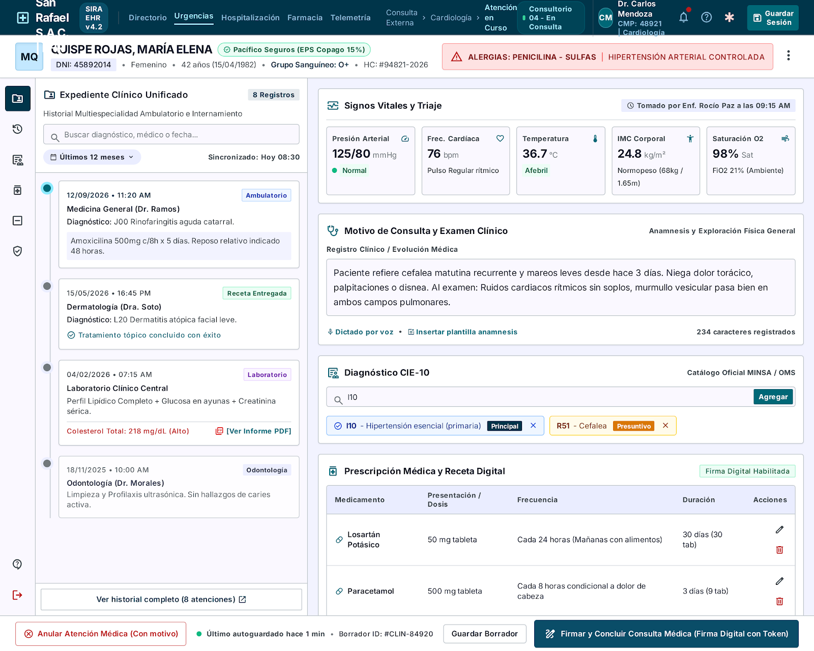
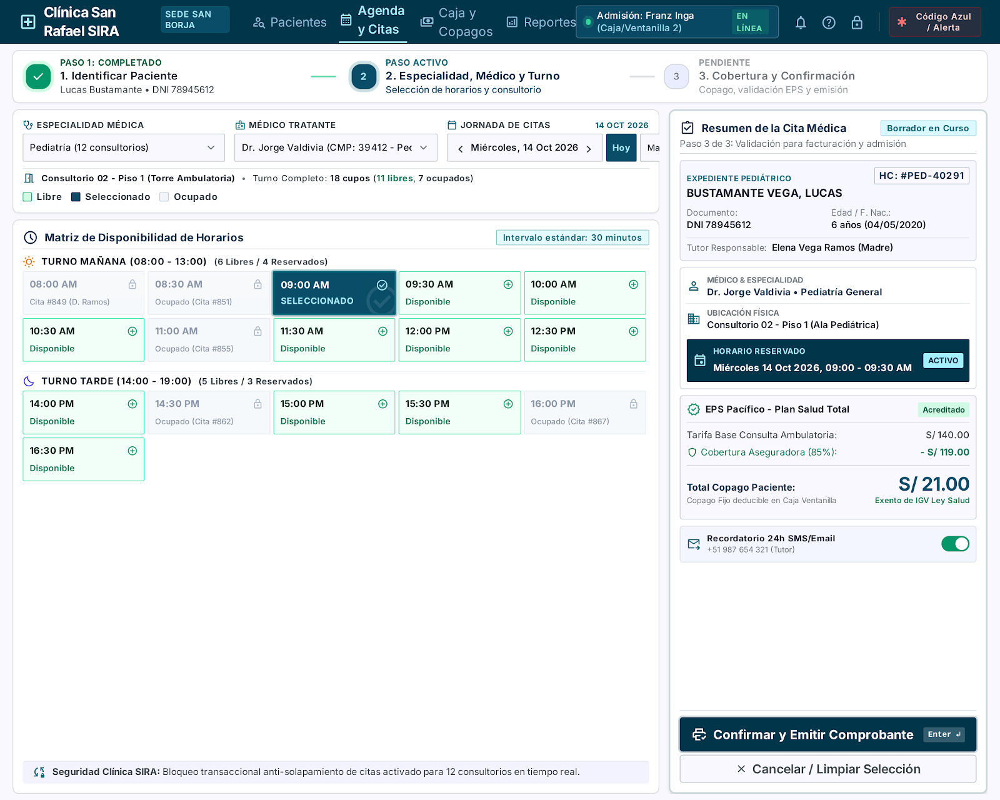
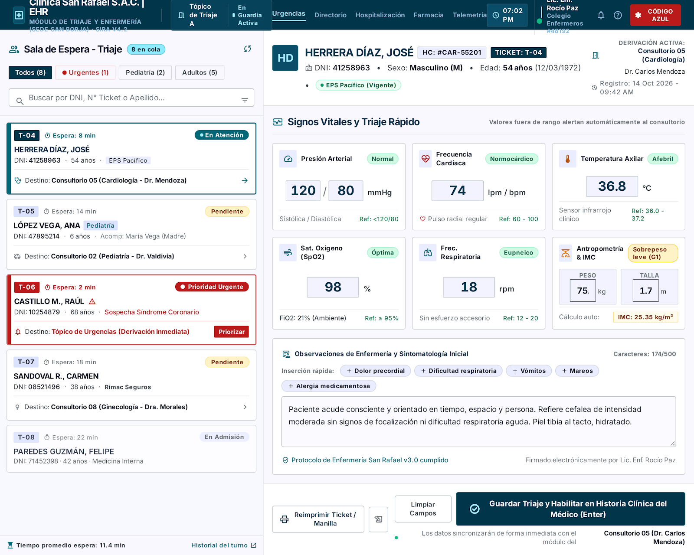
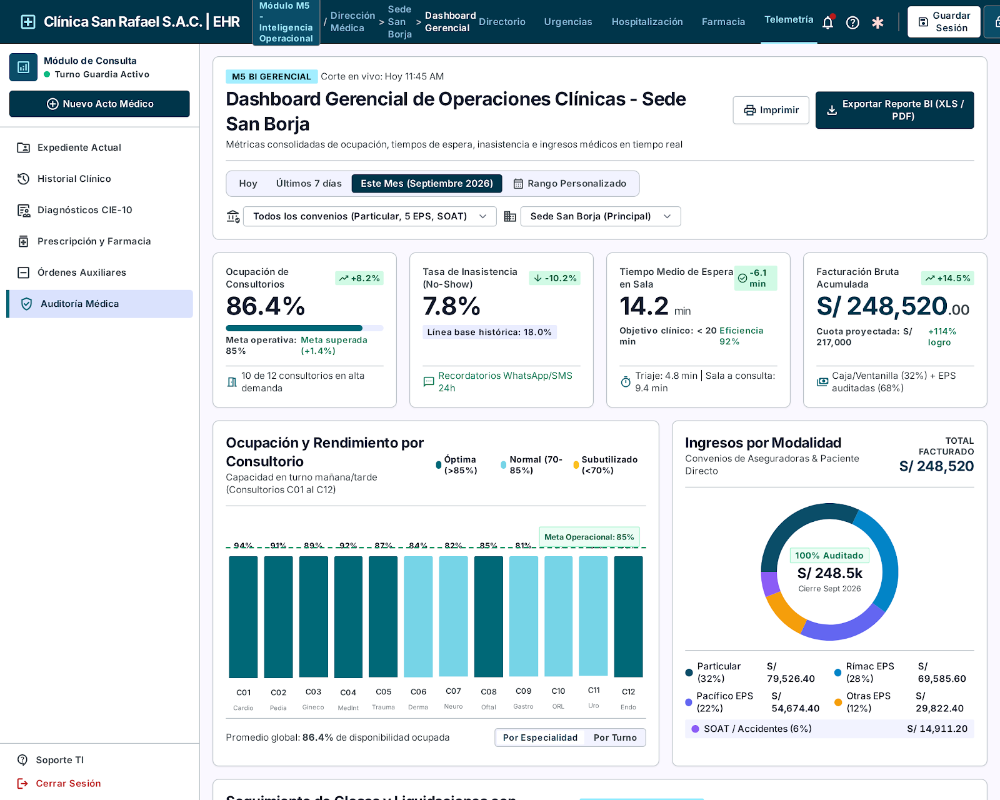

# 7. Prototipos UX/UI y Diseño de Interfaz de Usuario — Sistema SIRA

--------------------------------------------------------------------------------

### Contexto y Principios de Diseño Centrado en el Usuario (Semana 6)

El presente documento constituye la especificación formal del **Prototipo UX/UI y Diseño de Interfaz** para el **Sistema de Información Clínico-Administrativo (SIRA)** de la **Clínica San Rafael S.A.C. (Sede San Borja)**, desarrollado en el marco del curso Taller de Ingeniería de Software I (SW705).

El diseño de las interfaces de usuario traduce directamente los requerimientos funcionales y no funcionales de los documentos precedentes (`01-acta-constitucion.md`, `02-documento-vision.md`, `03-especificacion-requerimientos-ERS.md`, `04-modelosUML.md`, `05-arquitectura-SAD.md` y `06-modelo-base-datos.md`) en experiencias operativas tangibles, enfocadas en erradicar los cinco perjuicios históricos de la clínica:
1. **Seguridad clínica y visibilidad médica unificada:** Acceso inmediato a la Historia Clínica Electrónica con alertas destacadas de alergias para evitar errores de medicación (RF-001, RNF-001).
2. **Eficiencia en admisión y erradicación del no-show:** Flujo de agendamiento sin solapamientos en un máximo de 3 pasos (RF-002, RNF-005) con despacho automatizado de recordatorios 24 h (RF-003).
3. **Usabilidad inclusiva para personal con distinta alfabetización digital:** Interfaces limpias, con terminología médica estándar (CIE-10), componentes de alto contraste y baja carga cognitiva para evitar la resistencia al cambio (Riesgo R-02 del Acta).

#### Sistema de Diseño y Pautas Visuales (Design System SIRA)
* **Paleta de Colores Institucional:**
  * **Azul Clínico Principal (`#0A4D68` / `#088395`):** Denota sobriedad, confianza médica y autoridad en barras de navegación, botones primarios y títulos.
  * **Cyan / Teal de Acento (`#05BFDB` / `#EBF7F9`):** Fondos de selección, chips de estado activo y resaltado de consultorios disponibles.
  * **Rojo Carmesí Alerta Médica (`#DC2626` / `#FEE2E2`):** Exclusivo para alergias del paciente, contraindicaciones farmacológicas y cancelaciones críticas.
  * **Ámbar Preventivo (`#F59E0B` / `#FEF3C7`):** Observaciones de glosas, horarios próximos a vencer y citas en espera de confirmación.
  * **Verde Esmeralda Éxito (`#10B981` / `#D1FAE5`):** Citas confirmadas, resultados de laboratorio completados y copagos cancelados.
  * **Gris Neutro y Superficies (`#F8FAFC` fondo base, `#FFFFFF` tarjetas, `#64748B` textos secundarios, `#1E293B` textos principales).
* **Tipografía:** Familia `Inter` / `Roboto` (sin serifa, escala tipográfica jerárquica de 12px a 24px) para máxima legibilidad en monitores médicos de consultorio y terminales de recepción.
* **Componentes Base:** Tarjetas elevadas con sombra sutil (`box-shadow`), badges con bordes redondeados (`rounded-full`), inputs con validación en línea y botones con estados claros (Normal, Hover, Active, Disabled).

--------------------------------------------------------------------------------

## 7.1. Pantalla 1 — Registro de Atención y Consulta de HCE Unificada (Médico Tratante — M1)

### 7.1.1. Arquitectura de Información y Mapeo Funcional
* **Módulo Relacionado:** M1 — Historia Clínica Electrónica (HCE).
* **Usuario Objetivo:** Médico Tratante (Cardiología, Pediatría, Medicina General, etc.).
* **Trazabilidad:** RF-001 (HCE unificada), RF-004 (Órdenes digitales), RNF-001 (Apertura en $\le 2$ s con 8 000 registros), RNF-002 (RBAC y Ley N.° 29733), RNF-004 (Baja lógica sin borrado físico); Historias de Usuario HU01, HU04, HU08.
* **Estructura de la Pantalla:**
  1. **Barra Superior de Contexto del Paciente (Patient Banner):** Barra fija en la parte superior que muestra de forma perenne la fotografía/avatar del paciente, apellidos y nombres completos, tipo y número de documento (DNI), edad calculada, sexo biológico, tipo de sangre, aseguradora activa (ej. *Pacífico EPS - Plan Red Preferente*) y código de historia clínica.
  2. **Banner de Alerta Crítica (Alergias y Advertencias):** Franja roja destacada con icono de advertencia (`AlertTriangle`) inmediatamente debajo de los datos del paciente: *"ALERGIAS: PENICILINA / SULFAS — ASMA BRONQUIAL LEVE"*. Este componente mitiga directamente el riesgo de eventos adversos reportado en el caso.
  3. **Panel Lateral Izquierdo (35 % ancho) — Línea de Tiempo del Expediente Unificado:**
     * Buscador y filtro por especialidad o rango de fechas.
     * Lista cronológica paginada de atenciones históricas (Cardiología 15/08/2026, Dermatología 02/06/2026, Consulta Externa 10/01/2026).
     * Cada tarjeta de atención histórica muestra fecha, médico tratante, diagnóstico CIE-10 principal y un botón *"Ver detalle / Receta"*.
     * Sección de *"Resultados de Laboratorio e Imágenes vinculados"* con badges de estado y enlace de descarga de PDF digital.
  4. **Panel Central / Derecho (65 % ancho) — Acto Médico Actual:**
     * **Widget de Triaje (Solo Lectura):** Tarjeta horizontal con los signos vitales tomados previamente por enfermería (PA: 120/80 mmHg, FC: 78 lpm, Temp: 36.8 °C, Peso: 72.5 kg, Talla: 1.70 m, IMC: 25.1 Normal).
     * **Motivo de Consulta y Anamnesis:** Áreas de texto expandibles para el relato del paciente y examen físico.
     * **Diagnóstico CIE-10 (Buscador Predictivo):** Input con autocompletado en tiempo real que busca por código o descripción médica (ej. escribe *"J00"* y sugiere *"J00 - Rinofaringitis aguda [resfriado común]"*).
     * **Prescripción Médica (Receta Digital):** Tabla dinámica para agregar medicamentos (Medicamento, Concentración, Posología/Vía, Frecuencia y Duración).
     * **Barra de Acciones Inferior:**
       * Botón secundario *"Emitir Orden de Laboratorio / Imágenes"* (despliega modal).
       * Botón de anulación lógica *"Anular Registro"* (requiere confirmación y motivo).
       * Botón primario prominente *"Firmar y Finalizar Atención"*.

---

### 7.1.2. Marcador de Imagen para el Documento

---
## 7.2. Pantalla 2 — Agendamiento de Citas Médicas en 3 Pasos con Bloqueo de Solapamientos (Admisión — M2)

### 7.2.1. Arquitectura de Información y Mapeo Funcional
* **Módulo Relacionado:** M2 — Agenda y Citas Médicas.
* **Usuario Objetivo:** Personal de Admisión y Recepción (Ventanilla / Central telefónica).
* **Trazabilidad:** RF-002 (Bloqueo en tiempo real de solapamientos en 12 consultorios), RF-003 (Recordatorio automatizado con 24 h de anticipación), RNF-003 (Disponibilidad 99.5 %), RNF-005 (Agendamiento en un máximo de 3 pasos desde pantalla principal); Historias de Usuario HU02, HU03, HU06, HU07.
* **Estructura de la Pantalla en 3 Pasos (Cumplimiento Estricto de RNF-005):**
  1. **Indicador de Progreso Visual (Stepper Superior en 3 Pasos):**
     * *Paso 1:* Identificación y Validación del Paciente (Completado / Activo).
     * *Paso 2:* Especialidad, Médico y Horario Disponible (Activo).
     * *Paso 3:* Verificación de Cobertura y Confirmación (Pendiente).
  2. **Área de Contenido Dinámico:**
     * **Paso 1 (Búsqueda Predictiva de Paciente):**
       * Input destacado con selector de tipo de documento (DNI, Carné de Extranjería) y campo numérico con búsqueda reactiva en menos de 0.5 s.
       * Si el paciente existe: tarjeta con nombres, teléfono de contacto para recordatorios, correo electrónico y aseguradora vigente detectada automáticamente (*Rímac EPS / Copago S/ 25.00*).
       * Si el paciente no existe: botón rápido *"Registrar nuevo paciente en 30 segundos"* sin abandonar el flujo.
     * **Paso 2 (Matriz Consolidada de Disponibilidad y Consultorios):**
       * Filtros superiores inmediatos: Selector de Especialidad (*Medicina General, Pediatría, Traumatología, etc.*), Selector de Médico Tratante y selector de fecha/semana.
       * **Cuadrícula de Horarios (Grid Visual de Disponibilidad):**
         * Matriz interactiva de bloques horarios de 20 minutos (08:00 AM a 01:00 PM / 03:00 PM a 08:00 PM).
         * Bloques libres representados en **Verde Menta (`#D1FAE5`)** con borde teal: interactivos y clickeables.
         * Bloques ocupados representados en **Gris Deshabilitado (`#F1F5F9`)** con etiqueta *"Ocupado"* y candado de bloqueo para evitar solapamientos médicos y de consultorio físico.
         * Consultorio físico asignado (del 1 al 12) desplegado en cada tarjeta.
     * **Paso 3 (Panel Lateral de Resumen y Liquidación de Copago):**
       * Tarjeta flotante a la derecha con resumen de la cita: Médico seleccionado, consultorio físico (ej. *Consultorio 06 - Piso 2*), fecha y hora exacta.
       * Desglose del tarifario institucional: Tarifa base consulta (S/ 120.00), Cobertura EPS 80 % (-S/ 96.00), **Copago neto a cobrar al paciente: S/ 24.00**.
       * Interruptor de notificación: *"Enviar recordatorio por SMS y Correo Electrónico (24 horas antes)"* activado por defecto con el número móvil visible para edición.
       * Botón de confirmación primario *"Confirmar Cita y Emitir Ticket"*.

---

### 7.2.2. Marcador de Imagen para el Documento

---
## 7.3. Pantalla 3 (Complementaria) — Registro de Triaje y Signos Vitales (Enfermería — M1)

### 7.3.1. Arquitectura de Información y Mapeo Funcional
* **Módulo Relacionado:** M1 — Historia Clínica Electrónica (Triaje).
* **Usuario Objetivo:** Personal de Enfermería / Tópico de Urgencias.
* **Trazabilidad:** RF-001 (Captura de signos vitales asociada a la atención), RNF-003 (Disponibilidad en tópico continuo de urgencias), RNF-005 (Captura ágil en menos de 2 minutos); Historias de Usuario HU05, HU06.
* **Estructura de la Pantalla:**
  1. **Lista de Espera en Vivo (Cola de Pacientes en Tópico/Consulta):** Tabla izquierda con pacientes que hicieron *check-in* en admisión, tiempo de espera transcurrido, consultorio de destino y estado de triaje (*Pendiente* en amarillo / *Completado* en verde).
  2. **Formulario Ergonómico de Medición Asistencial:**
     * Panel numérico de gran tamaño para ingreso rápido de Presión Arterial (Sistólica/Diastólica), Frecuencia Cardíaca, Temperatura axilar, Frecuencia Respiratoria y Saturación de Oxígeno ($SpO_2$).
     * Calculador automático integrado de Índice de Masa Corporal (IMC) a partir de los campos Peso (kg) y Talla (m), categorizando visualmente el resultado (Bajo peso, Normal, Sobrepeso, Obesidad).
     * Checkbox de confirmación de alergias y observaciones rápidas.
     * Botón de guardado *"Registrar Triaje y Transferir a Consultorio"*.

---

### 7.3.2. Marcador de Imagen para el Documento

---
## 7.4. Pantalla 4 (Complementaria) — Dashboard Gerencial de Indicadores Operativos (Gerencia Médica — M5)

### 7.4.1. Arquitectura de Información y Mapeo Funcional
* **Módulo Relacionado:** M5 — Reportes Gerenciales y BI.
* **Usuario Objetivo:** Dirección Médica y Gerencia General de la Clínica.
* **Trazabilidad:** RF-008 (Dashboard con ocupación, espera, ingresos y no-show), RNF-002 (Acceso restringido por rol de gerencia sin datos clínicos confidenciales expuestos), RNF-003 (Métricas operativas consolidadas); Historias de Usuario HU12.
* **Estructura de la Pantalla:**
  1. **Barra Superior de Filtros Analíticos:** Selector de rango de fechas (*Hoy, Esta Semana, Septiembre 2026, Personalizado*), filtro por especialidad médica y filtro por tipo de convenio asegurador.
  2. **Tarjetas de KPIs Principales (Top Stat Cards):**
     * **Tasa de Ocupación de Consultorios:** *86.4 %* (con indicador de variación $+8.2\,\%$ vs. mes previo, base de 12 consultorios).
     * **Tasa de Inasistencia (No-Show):** *7.8 %* (mostrando reducción de 10.2 puntos porcentuales respecto a la línea base histórica del 18 % gracias a los recordatorios 24 h).
     * **Tiempo Promedio de Espera en Sala:** *14.2 min* (reducción drástica frente a las demoras históricas).
     * **Ingresos Operativos Totales:** *S/ 248,500.00* (Particular 35 %, EPS 55 %, SOAT 10 %).
  3. **Gráficos Analíticos Centrales:**
     * Gráfico de barras de ocupación y atenciones por cada uno de los 12 consultorios físicos.
     * Gráfico de pastel/anillo de distribución de facturación por aseguradora (Particular, Pacífico, Rímac, Mapfre, Sanitas, La Positiva, SOAT).
     * Tabla inferior con balance de glosas registradas, sustentadas y recuperadas ante las EPS.

---

### 7.4.2. Marcador de Imagen para el Documento

  
---
## 7.5. Flujo de Navegación del Prototipo (User Flow)

La siguiente tabla describe formalmente la secuencia operativa mediante la cual los usuarios del sistema transitan a través de las pantallas principales del prototipo, validando el cumplimiento estricto de la regla de usabilidad en **máximo 3 pasos (RNF-005)** y la segregación de accesos por rol (RBAC):

| Paso | Pantalla Origen | Acción del Usuario / Evento del Sistema | Pantalla Destino | Componente de Validación y Trazabilidad |
| :---: | :--- | :--- | :--- | :--- |
| **Paso 1** | Pantalla de Acceso (Login) | El usuario ingresa sus credenciales corporativas (usuario y contraseña cifrada con bcrypt). El sistema autentica y genera token JWT validando el rol asignado en la base de datos (RNF-002). | Dashboard Principal según Rol (Médico, Admisión, Enfermera o Gerencia) | Middleware RBAC en FastAPI restringe menús y módulos no autorizados. |
| **Paso 2** | Dashboard de Admisión | El operador de recepción busca al paciente por DNI en el buscador rápido. Si existe, selecciona su registro y pulsa *"Nueva Cita"*. (Paso 1 del Agendamiento). | Pantalla 2 — Agendamiento (Paso 2: Matriz de Turnos) | Búsqueda indexada en PostgreSQL resuelve la consulta de filiación en < 0.5 s. |
| **Paso 3** | Pantalla 2 — Matriz de Turnos | El operador filtra la especialidad médica, selecciona el médico tratante y hace clic sobre un bloque horario disponible (en verde). (Paso 2 del Agendamiento). | Pantalla 2 — Panel de Resumen Lateral (Paso 3) | El motor de agenda valida en tiempo real la disponibilidad y previene solapamientos (RF-002). |
| **Paso 4** | Pantalla 2 — Resumen Lateral | El operador verifica la cobertura del convenio (Particular/EPS/SOAT), el monto de copago calculado automáticamente y hace clic en *"Confirmar Cita"*. (Paso 3 del Agendamiento). | Modal de Éxito / Emisión de Ticket de Cita | La cita se guarda en base de datos e inserta el evento en `outbox_notificaciones` para el envío 24 h antes (RF-003, RNF-005). |
| **Paso 5** | Pantalla 3 — Cola de Espera (Enfermería) | Al presentarse el paciente en la clínica, la enfermera selecciona su ticket en espera y registra los signos vitales en el formulario ergonómico de triaje. | Pantalla 3 — Triaje Guardado | Los signos vitales se persisten en la tabla `triajes` y quedan vinculados a la atención del día (RF-001). |
| **Paso 6** | Pantalla 1 — Consulta Médica (Médico) | El médico tratante hace clic sobre el paciente citado en su agenda diaria. El sistema carga el expediente unificado cronológico con alerta destacada de alergias y el triaje tomado por enfermería. | Pantalla 1 — HCE y Consulta Activa | Apertura garantizada en < 2 segundos sobre 8 000 registros (RNF-001, RNF-004). |
| **Paso 7** | Pantalla 1 — Consulta Médica | El médico ingresa el diagnóstico CIE-10 asistido por autocompletado predictivo, formula la receta médica, emite órdenes de laboratorio si lo amerita y pulsa *"Firmar y Concluir Consulta"*. | Modal de Confirmación y Retorno a Agenda Médica | Transacción ACID guarda el acto médico, receta y órdenes, registrando la traza en `bitacora_auditoria` (Ley N.° 29733). |

--------------------------------------------------------------------------------

## 7.6. Checklist de Usabilidad y Calidad UX/UI (Rúbrica E1 - Semana 6)

| Criterio de Calidad UX/UI | Estado | Justificación y Evidencia en el Prototipo |
| :--- | :---: | :--- |
| **Alineamiento con Historias de Usuario (INVEST)** | **Cumple** | Las pantallas reflejan fielmente las historias prioritarias del Sprint 1: HU01 (HCE unificada), HU02 (Agendamiento sin solapamientos), HU04 (Consulta CIE-10), HU05 (Triaje) y HU07 (Recordatorios). |
| **Cumplimiento del Límite de 3 Pasos (RNF-005)** | **Cumple** | La Pantalla 2 implementa un stepper guiado que permite reservar una cita médica en exactamente 3 interacciones: (1) Buscar paciente, (2) Elegir turno libre, (3) Confirmar con copago. |
| **Prevención de Errores Médicos (Seguridad Clínica)** | **Cumple** | La Pantalla 1 sitúa el banner de alergias en color rojo carmesí `#DC2626` en la zona superior de atención inmediata, previniendo prescripciones adversas. |
| **Baja Carga Cognitiva y Brecha Digital (Riesgo R-02)** | **Cumple** | Diseño minimalista con alto contraste, etiquetas en lenguaje clínico natural, buscadores predictivos (CIE-10) y componentes deshabilitados claramente diferenciados. |
| **Percepción de Rendimiento en < 2 s (RNF-001)** | **Cumple** | La división modular de pantallas desacopla la carga pesada mediante carga asíncrona (*lazy loading*) y componentes de esqueleto (*skeleton screens*) mientras consulta PostgreSQL. |
| **Insumos Listos para Generación de Mockups (Stitch IA)** | **Cumple** | Cada una de las 4 pantallas cuenta con su especificación de componentes y su prompt exhaustivo listo para copiar y pegar en herramientas de IA. |
